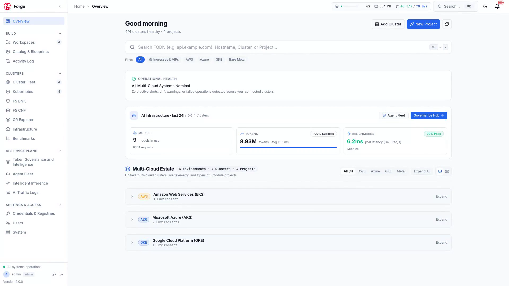

# `gkebnkctl` — Google Cloud GKE F5 BIG-IP Next for Kubernetes (BNK) Engine

[](go.mod)
[](LICENSE)
[](#the-bnkctl-multi-cloud-family)

`gkebnkctl` is a **pure-Go lifecycle and validation CLI** for deploying, operating, upgrading, benchmarking, and tearing down **F5 BIG-IP Next for Kubernetes (BNK)** and **F5 BNK AI Service Plane** estates on **Google Kubernetes Engine (GKE)** — with native integration into [**F5 BNK Forge**](https://github.com/JLCode-tech/bnk-forge).

> **Preferred Multi-Cloud CLI**: [**`bnkctl`**](https://github.com/JLCode-tech/bnkctl) is the **preferred unified multi-cloud CLI** for deploying F5 BNK across **AWS EKS**, **Azure AKS**, and **Google Cloud GKE** from a single binary. `gkebnkctl` is the standalone GCP-pinned CLI in the same family and shares the same engine, command surface, and declarative `cluster.yaml` model.



---

## Why `gkebnkctl`?

Deploying a **BIG-IP Next for Kubernetes (BNK)** and **F5 BNK AI Service Plane** on Google Cloud GKE traditionally requires stitching together cloud-specific Terraform modules, multi-VPC CNI plumbing, GKE multi-network pod attachments, Jumbo Frame MTU configurations, Helm charts, and post-install reconciliations.

`gkebnkctl` replaces that complexity with **one declarative `cluster.yaml` intent file** and **one pure-Go engine**:

- **Part of the `bnkctl` Family**: Shares the same architecture and CLI experience as [**`bnkctl`**](https://github.com/JLCode-tech/bnkctl) (the preferred unified multi-cloud CLI), [**`awsbnkctl`**](https://github.com/JLCode-tech/awsbnkctl), and [**`azrbnkctl`**](https://github.com/JLCode-tech/azrbnkctl).
- **Pure Google Cloud & Kubernetes SDKs**: Provisions multi-VPC networks (`main`, `external`, `internal`) with Jumbo Frames (`MTU 8896`), Cloud NAT/Routers, firewall rules, GKE multi-network node pools (`virtio`), IAP jumphosts, and passthrough Network Load Balancers directly via `cloud.google.com/go`, `client-go`, and the Helm v3 Go SDK.
- **Version-Aware BNK Release Catalog**: Built-in support for BNK **2.3.x** (`legacy-spk`), **2.4.0**, **2.4.1**, and **future release** (`gateway-infra`), including automatic release-quirk self-healing (`gkebnkctl heal`) and cross-train migration (`gkebnkctl migrate`). See the [F5 BIG-IP Next for Kubernetes CloudDocs](https://clouddocs.f5.com/bigip-next-for-kubernetes/latest/overview.html) for full platform documentation.
- **Turnkey BNK Forge & F5 BNK AI Service Plane**: Automatically registers clusters with [**F5 BNK Forge**](https://github.com/JLCode-tech/bnk-forge) during `gkebnkctl up`, seeds AI Token Governance and Smart LLM Routing for **Google Vertex AI (Gemini)**, and cleans up on `gkebnkctl down`.
- **Zero-Leak Teardown**: Deterministic reverse-dependency teardown (`gkebnkctl down`) strips stuck Kubernetes finalizers, sweeps orphaned `pvc-*` persistent disks, removes forwarding rules and custom VPCs, deletes the GKE cluster, and unregisters from [BNK Forge](https://github.com/JLCode-tech/bnk-forge).

---

## The `bnkctl` Multi-Cloud Family

[**`bnkctl`**](https://github.com/JLCode-tech/bnkctl) is the preferred unified CLI across all three hyperscalers, while `awsbnkctl`, `azrbnkctl`, and `gkebnkctl` provide standalone single-cloud binaries:

| CLI & Repository | Status | Target Cloud | Default Underlay & Dataplane Architecture |
| :--- | :--- | :--- | :--- |
| [**`bnkctl`**](https://github.com/JLCode-tech/bnkctl) | **Preferred (Unified)** | **AWS, Azure, GCP** | Auto-detects cloud provider from `cluster.yaml` (`apiVersion` or `cloud.provider`) or `--cloud aws\|azure\|gcp`. |
| [**`awsbnkctl`**](https://github.com/JLCode-tech/awsbnkctl) | Single-Cloud (AWS) | **AWS EKS** | VPC + Public/Private/DataPath Subnets (including AWS Local Zones), Multus + `host-device` / SR-IOV secondary ENIs, AWS Route Server BGP peering. |
| [**`azrbnkctl`**](https://github.com/JLCode-tech/azrbnkctl) | Single-Cloud (Azure) | **Azure AKS** | VNet + System & TMM Node Pools, Accelerated Networking (`dual-interface`), dynamic secondary NIC attachment, VXLAN egress / L4 load balancing. |
| [**`gkebnkctl`**](https://github.com/JLCode-tech/gkebnkctl) | Single-Cloud (GCP) | **GCP GKE** | Multi-VPC (`main`, `external`, `internal`) with Jumbo Frames (MTU 8896), GKE multi-network pod attachments (`virtio`), Cloud NAT & IAP jumphost. |

---

## What You Can Build with `gkebnkctl` + [BNK Forge](https://github.com/JLCode-tech/bnk-forge)

When `forge.enabled: true` is set in your `cluster.yaml`, `gkebnkctl up` automatically bridges your Google Cloud GKE cluster into [**BNK Forge**](https://github.com/JLCode-tech/bnk-forge) — giving you a visual control plane for BNK lifecycle, security policy authoring, AI token governance, and LLM benchmarking.

### 1. Unified Multi-Cloud Cluster Fleet & Blueprints Catalog

As soon as `gkebnkctl up` completes Forge registration, your GKE cluster appears in the [**BNK Forge**](https://github.com/JLCode-tech/bnk-forge) **Cluster Fleet** alongside your multi-cloud estate with live data-plane telemetry, active listeners, L4/L7 routes, and one-click deployable **Blueprints**.


### 2. Visual Network Security & Traffic Policy Management

Author, visualize, and enforce L4/L7 traffic routing, carrier-grade network translation, DNS delivery, and zero-trust security policies across your Kubernetes clusters from a single visual interface or declaratively via `gkebnkctl`. For complete details on F5 BIG-IP Next for Kubernetes traffic and security capabilities, see the [F5 BIG-IP Next for Kubernetes CloudDocs](https://clouddocs.f5.com/bigip-next-for-kubernetes/latest/overview.html).


### 3. F5 BNK AI Service Plane: Token Governance & Data Guardrails

Deliver enterprise-grade AI traffic governance on Google Cloud with real-time token accounting, budget and rate enforcement, sensitive data (PII/DLP) guardrails, and prompt-injection protection managed through [**BNK Forge**](https://github.com/JLCode-tech/bnk-forge). Learn more about F5's cloud-native data plane and AI traffic capabilities in the [F5 BIG-IP Next for Kubernetes CloudDocs](https://clouddocs.f5.com/bigip-next-for-kubernetes/latest/overview.html).


### 4. Smart LLM Router Fleet for Google Vertex AI (Gemini)

Route agentic and inference traffic across primary and fallback foundation models in **Google Vertex AI** (Gemini 2.5 Pro / Gemini 2.5 Flash) — complete with Model Context Protocol (MCP) tool security and weighted failover:


### 5. Automated GenAI & Dataplane Benchmarking (`aiperf` + 15 Built-in Scenarios)

Compare throughput, Time-to-First-Token (TTFT), Inter-Token Latency (ITL), and token-rate enforcement across **F5 BNK + F5 GAIE**, Envoy, HAProxy, and `llm-d` Router, or run any of the 15 built-in Kubernetes validation scenarios (`gkebnkctl scenarios run`):


### 6. AI-Assisted Day-2 Operations via 153 MCP Server Tools

Every cluster registered by `gkebnkctl` can be inspected, diagnosed, and operated through [BNK Forge](https://github.com/JLCode-tech/bnk-forge)'s built-in **Model Context Protocol (MCP) Server**, exposing 153 structured tools for AI assistants and automation pipelines:


---

## Quickstart

### Prerequisites

1. **Go 1.26+** (to build from source) or a pre-built release binary from [GitHub Releases](https://github.com/JLCode-tech/gkebnkctl/releases).
2. **F5 BIG-IP Next for Kubernetes License & Registry Access** (gitignored locally; never committed):
   - Follow the [F5 BIG-IP Next for Kubernetes CloudDocs](https://clouddocs.f5.com/bigip-next-for-kubernetes/latest/overview.html) to obtain your F5 subscription JWT (`license.jwt`) and configure F5 Artifact Registry (`repo.f5.com`) pull credentials.
3. **Google Cloud Credentials**:
   - Application Default Credentials (`gcloud auth application-default login`) and `GOOGLE_CLOUD_PROJECT` set to your target GCP project ID.

### 1. Build the CLI

```bash
git clone https://github.com/JLCode-tech/gkebnkctl.git
cd gkebnkctl
go build -o ./gkebnkctl ./cmd/gkebnkctl
```

### 2. Validate & Dry-Run Any Example Offline

You can validate any `cluster.yaml` and preview the full GCP underlay + BNK overlay execution plan without touching live Google Cloud APIs:

```bash
# GCP GKE + Vertex AI Gemini + F5 BNK AI Service Plane (2.4.1)
./gkebnkctl validate -c examples/vertex-agent-demo/cluster.yaml
./gkebnkctl up -c examples/vertex-agent-demo/cluster.yaml --dry-run

# Multi-Protocol L4/L7 Ingress Blueprint
./gkebnkctl validate -c examples/multi-protocol-ingress/cluster.yaml
./gkebnkctl up -c examples/multi-protocol-ingress/cluster.yaml --dry-run
```

### 3. Deploy End-to-End (`gkebnkctl up`)

```bash
# Deploy using gkebnkctl (or use the preferred unified `bnkctl up -c ...`)
./gkebnkctl up -c examples/vertex-agent-demo/cluster.yaml
```

### 4. Inspect, Heal, Benchmark & Teardown

```bash
# Check GCP underlay, TMM dataplane, BNK release profile, and active quirks
./gkebnkctl status -c examples/vertex-agent-demo/cluster.yaml

# Run BNK release-quirk self-healing and route pool resync
./gkebnkctl heal -c examples/vertex-agent-demo/cluster.yaml
./gkebnkctl bnk resync -c examples/vertex-agent-demo/cluster.yaml

# Verify BNK Forge registration & F5 BNK AI Service Plane governance readiness
./gkebnkctl forge status -c examples/vertex-agent-demo/cluster.yaml
./gkebnkctl forge governance overview -c examples/vertex-agent-demo/cluster.yaml

# Run validation scenarios (L4 TCP/UDP, gRPC, HTTP routing, Egress SNAT, AI Token Counting)
./gkebnkctl scenarios list
./gkebnkctl scenarios run http-routing-e2e -c examples/vertex-agent-demo/cluster.yaml

# Tear down all GCP & cluster resources cleanly with zero leaked PVC disks or VPCs
./gkebnkctl down -c examples/vertex-agent-demo/cluster.yaml
```

---

## Command Reference

| Command | Description |
| :--- | :--- |
| `gkebnkctl up` | Provision GCP underlay (multi-VPC networks, Cloud NAT, GKE multi-network cluster, IAP jumphost) and deploy the BNK overlay stack + [BNK Forge](https://github.com/JLCode-tech/bnk-forge) registration |
| `gkebnkctl down` | Tear down BNK overlay, strip stuck finalizers, sweep orphaned PVC disks, unregister from [BNK Forge](https://github.com/JLCode-tech/bnk-forge), and destroy all GCP underlay resources |
| `gkebnkctl status` | Inspect GCP underlay state, BNK release train/profile, TMM dataplane readiness, and active release quirks |
| `gkebnkctl validate` | Validate `cluster.yaml` intent and dry-run render all BNK overlay manifests |
| `gkebnkctl doctor` | Verify local prerequisites, GCP credentials, registry pull credentials, and subscription JWT validity |
| `gkebnkctl heal` | Run idempotent BNK self-healing and version-specific quirk reconciliations |
| `gkebnkctl upgrade` | Upgrade BNK overlay in-place within the same architectural release train |
| `gkebnkctl migrate` | Migrate BNK overlay across architectural release boundaries (e.g., `2.3.x legacy-spk` -> `2.4.x/future gateway-infra`) |
| `gkebnkctl bnk {status,scan,heal,resync,upgrade,migrate}` | Granular BNK overlay inspection, MCP endpoint scanning, and pool-member resynchronization |
| `gkebnkctl forge {register,unregister,status,governance}` | Register/unregister clusters with [BNK Forge](https://github.com/JLCode-tech/bnk-forge) and manage F5 BNK AI Service Plane governance |
| `gkebnkctl scenarios {list,show,run}` | List, inspect, and execute 15 built-in BNK L4/L7, egress, and GenAI validation scenarios |
| `gkebnkctl test {connectivity,dns}` | Execute TCP/UDP VIP connectivity and DNS probes from the cluster jumphost or probe pod |
| `gkebnkctl genai parse` | Parse `aiperf` benchmark artifacts into structured [BNK Forge](https://github.com/JLCode-tech/bnk-forge) GenAI telemetry |
| `gkebnkctl k` | In-process Kubernetes `client-go` operations with automatic cluster template variable rendering |
| `gkebnkctl topology` | Render cluster network and TMM dataplane interface topology |

---

## Example GCP Blueprints (`examples/`)

| Directory | Region / Mode | Architecture & Use Case |
| :--- | :--- | :--- |
| [`examples/vertex-agent-demo/`](examples/vertex-agent-demo/) | **GCP GKE (`australia-southeast1-a`)** | Multi-VPC Jumbo-Frame GKE + F5 BNK AI Service Plane (2.4.1) + Google Vertex AI (Gemini 2.5 Pro/Flash) + VXLAN Egress |
| [`examples/ingress/`](examples/ingress/) | **GCP GKE (`virtio`)** | Standard multi-VPC GKE ingress deployment with passthrough Network Load Balancer |
| [`examples/multi-protocol-ingress/`](examples/multi-protocol-ingress/) | **GCP GKE (`virtio`)** | Combined HTTP, HTTPS, TCP, UDP, and gRPC ingress validation |
| [`examples/egress/`](examples/egress/) | **GCP GKE (`virtio`)** | Outbound SNAT, VXLAN egress, and deterministic source-IP validation |
| [`examples/host-device/`](examples/host-device/) | **GCP GKE (`host-device`)** | Direct NIC netns move (`host-device`) dataplane topology |

---

## Documentation Index

- [**Unified Multi-Cloud CLI (`JLCode-tech/bnkctl`)**](https://github.com/JLCode-tech/bnkctl) — The preferred unified multi-cloud CLI for AWS EKS, Azure AKS, and Google Cloud GKE.
- [**Architecture & Design (`docs/ARCHITECTURE.md`)**](docs/ARCHITECTURE.md) — Google Cloud GKE multi-VPC underlay, multi-network pod attachments, and BNK overlay architecture.
- [**BNK Forge & F5 BNK AI Service Plane Integration (`docs/FORGE_INTEGRATION.md`)**](docs/FORGE_INTEGRATION.md) — Visual walkthrough of [BNK Forge](https://github.com/JLCode-tech/bnk-forge) cluster registration, policy building, AI token governance, and Smart LLM Routing.
- [**Commands Reference (`docs/COMMANDS.md`)**](docs/COMMANDS.md) & [**Validation Scenarios (`docs/SCENARIOS.md`)**](docs/SCENARIOS.md) — Detailed CLI flags and 15 built-in validation scenarios.
- [**F5 BIG-IP Next for Kubernetes CloudDocs**](https://clouddocs.f5.com/bigip-next-for-kubernetes/latest/overview.html) — Official F5 product documentation, architecture guides, and prerequisite setup.

---

## License

Released under the [MIT License](LICENSE).
