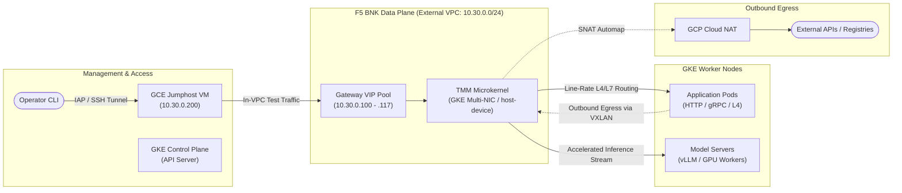
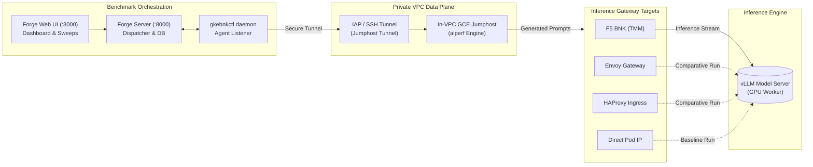
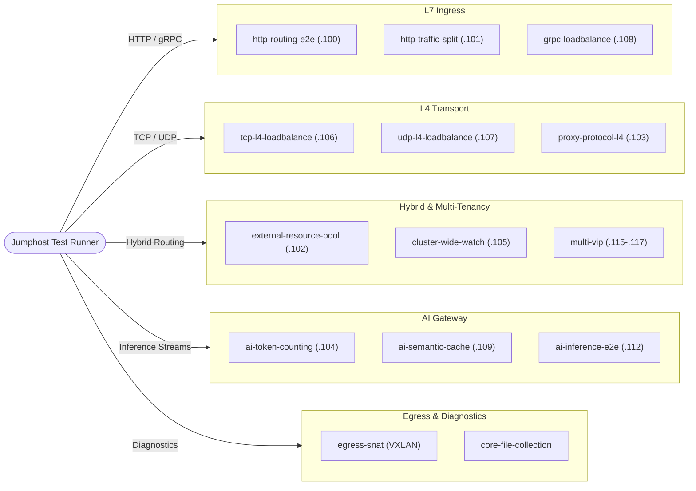
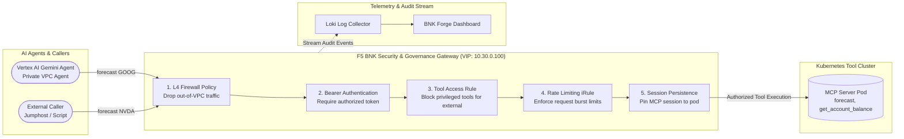

# gkebnkctl


[](https://github.com/JLCode-tech/gkebnkctl/actions/workflows/ci.yml)
[](https://github.com/JLCode-tech/gkebnkctl/releases)
[](LICENSE)

**Deploy, operate, and benchmark F5 BIG-IP Next for Kubernetes (BNK) on Google Kubernetes Engine (GKE) from a single binary.**  
Zero Terraform. Zero host `kubectl`. Zero host `helm`.

---

`gkebnkctl` automates the entire lifecycle of enterprise F5 BNK deployments on Google Kubernetes Engine (GKE). From a single declarative `cluster.yaml`, it provisions the 3-VPC network topology (management, external data-plane, internal data-plane), GKE Datapath V2 multi-networking node pools, `host-device` NetworkAttachmentDefinitions (NADs), PCI passthrough discovery, and the full F5 BNK 2.4 software stack. It includes **15 built-in automated traffic validation scenarios**, an enterprise **AI inference benchmarking suite** (`aiperf`), and **AI agent governance walkthroughs** (`examples/vertex-agent-demo/`).

---

## Table of Contents

- [Why gkebnkctl?](#why-gkebnkctl)
- [System Architecture & Network Topology](#system-architecture--network-topology)
- [AI Inference Benchmarking & Comparative Shootouts](#ai-inference-benchmarking--comparative-shootouts)
- [15 Built-in Validation Scenarios](#15-built-in-validation-scenarios)
- [Architecture & Protocol Demos](#architecture--protocol-demos)
- [Quick Start](#quick-start)
- [Interface Patterns](#interface-patterns)
- [Pinned Ecosystem Versions](#pinned-ecosystem-versions)
- [CLI Command Taxonomy](#cli-command-taxonomy)
- [Documentation & The `*bnkctl` Family](#documentation--the-bnkctl-family)

---

## Why gkebnkctl?

Deploying F5 BIG-IP Next for Kubernetes (BNK) on GCP typically requires coordinating multiple infrastructure layers:
- 3-VPC network segmentation with a dedicated cluster-owned management VPC (`10.60.0.0/24`) and shared or dedicated external (`10.30.0.0/24`) and internal (`10.50.0.0/24`) data-plane VPCs, Cloud Routers, and Cloud NATs.
- GKE Datapath V2 multi-networking node pools (`tmm-pool`, `agent-pool`) with secondary `tmm-ext` and tertiary `tmm-int` NICs and `/28` alias IP slices.
- Host-level Linux tuning: `host-device` Multus NADs, runtime PCI passthrough address discovery (`PCIDEVICE_INTEL_COM_EXT` / `PCIDEVICE_INTEL_COM_INT`), `bnk-node-sysctls`, and `/var/crash` volume injection.
- Cloud-native F5 control-plane lifecycle (FLO, CNE, IPAM controllers, `coredns-f5` stubDomains for DSSM HA) and Kubernetes Gateway API / SPK CRDs.
- Live data-plane traffic validation inside private VPCs via a dual-NIC GCE jumphost VM (`10.30.0.200`) over IAP SSH without exposing workloads to the public internet.

`gkebnkctl` consolidates this entire workflow into a **single, dependency-free binary**:

- **Zero Prerequisites**: No Terraform, Helm, `gcloud`, or external `kubectl` required on the host—everything is driven natively via the GCP Go SDK and `client-go`.
- **Deterministic State Machine**: 21 sequential phases (`00`–`51`) execute with full idempotency, resume safety, and explicit state verification.
- **Built-in Diagnostics & Healing**: The `gkebnkctl bnk heal` command detects and automatically remediates 9 common Kubernetes plumbing issues (Multus token expiration, TMM log streams, pod-manager tags, CWC certs, DSSM probes, EndpointSlice RBAC, and `route-k8s-pods` static routes).
- **In-VPC Validation**: 15 built-in automated test scenarios validate L4/L7 routing, canary splits, gRPC streams, and AI inference directly inside the GCP VPC.
- **Clean Teardown**: `gkebnkctl down -f cluster.yaml --yes` destroys cluster-owned resources and per-cluster dataplane subnets in reverse dependency order while preserving shared dataplane VPCs.

---

## System Architecture & Network Topology

`gkebnkctl` provisions a 3-VPC GKE topology with dedicated network segmentation for management and high-performance TMM traffic:



### Key Architectural Tenets
1. **Isolated 3-VPC Data Path**: TMM attaches to dedicated secondary (`tmm-ext`, `10.30.0.0/24`, MTU 8896) and tertiary (`tmm-int`, `10.50.0.0/24`, MTU 8896) VPC interfaces via GKE Datapath V2 multi-networking, `host-device` Multus NADs, and PCI passthrough (`PCIDEVICE_INTEL_COM_EXT` / `_INT`).
2. **Deterministic IP Allocation**: VIPs live in a fixed pool (`10.30.0.100` through `.117`), the dual-NIC GCE jumphost test client owns `10.30.0.200`, and TMM `/28` secondary pod alias slices are automatically resolved into `F5SPKVlan` self-IPs.
3. **Transparent Outbound Egress & Symmetric VXLAN Return Routing**: Outbound pod traffic from `agent-pool` routes over a VXLAN tunnel (`vxlan100`, key `100`, port `5789`) directly into TMM, where Phase 51 discovers each node's VTEP IP and reconciles symmetric `F5SPKStaticRoute` return routes (`route-k8s-pods`) alongside `F5SPKEgress` and `F5SPKSnatpool`.
4. **Gateway API & BNK 2.4 Native**: Uses `CNEInstance` (`f5.com/v1alpha1`), `F5BnkGateway` (`k8s.f5net.com/v1`), standard Kubernetes Gateway API (`GatewayClass`, `Gateway`, `HTTPRoute`, `GRPCRoute`), and `coredns-f5` `stubDomains` forwarding for DSSM Redis Sentinel HA.

---

## AI Inference Benchmarking & Comparative Shootouts

`gkebnkctl` embeds an AI performance benchmarking engine powered by NVIDIA's `aiperf`. It measures real-world GenAI latency and throughput from within the private GCP VPC data plane and synchronizes with **BNK Forge** for real-time visualization and comparative analysis.

### Benchmarking Execution Flow



### Built-in Smoke Presets (`--scenarios`)

| Preset | Concurrency | Requests | ISL (Input) | OSL (Output) | Mode | Target Workload |
|---|:---:|:---:|:---:|:---:|:---:|---|
| `latency` | 1 | 50 | 512 | 128 | Stream | Single-user baseline TTFT without queue delay |
| `throughput` | 32 | 500 | 512 | 128 | Batch | Maximum sustained token throughput under load |
| `long-context` | 4 | 50 | 4096 | 512 | Stream | Memory bandwidth & KV cache expansion test |
| `streaming` | 8 | 200 | 512 | 256 | Stream | Conversational multi-user SSE stream delivery |

### Native Forge Scenarios (`--scenario`)

For exhaustive evaluations and performance characterization, `gkebnkctl` supports 8 native synthetic Forge engines plus production trace replay:

- **`baseline`**: Concurrency sweep across 50, 100, 150, 200 concurrent streams.
- **`high-concurrency`**: Heavy prompt pairs up to 300 concurrency with 10k token prompts.
- **`mixed-workload`**: Three-phase adaptive sweep (Warmup $\to$ Short ISL $\to$ Long ISL with prefix sharing).
- **`multi-turn`**: Four-turn conversation simulation with progressively expanding shared prefix (500, 1000, 1500 tokens).
- **`prefix-cache`**: Evaluates KV-cache hit rate and TTFT latency drop across 20 shared prompt pools (80% prefix overlap).
- **`bimodal`**: Two-mode distribution modeling real traffic (70% short 300-token queries, 30% long 4000-token queries).
- **`sustained-load`**: Endurance test running up to 2,500 requests per concurrency step.
- **`burst-recovery`**: 5 rounds alternating between high-load bursts ($c=200$) and low-load probes ($c=25$) to measure queue recovery.
- **`mooncake`**: Open-loop replay of production tool-agent traces with 0.80x time-dilation.

### Multi-Proxy Shootouts (`--proxies`)

Run head-to-head comparisons against Envoy, HAProxy, NGINX, and direct NodePort:

```bash
gkebnkctl benchmark run -f cluster.yaml \
  --proxies f5-bnk,envoy,haproxy,nodeport \
  --scenario baseline,prefix-cache \
  --run-label proxy-shootout
```

### GenAI Metrics Captured
- **TTFT (Time to First Token)**: p50, p90, p95, p99 percentiles.
- **ITL (Inter-Token Latency)**: p50, p95, p99 percentiles for streaming chunks.
- **Token Throughput**: Input, output, and aggregate tokens per second.
- **Prefix Cache Hit Rate**: Real-time GPU KV cache hit ratio delta scraped from vLLM/EPP Prometheus metrics.

*(Detailed documentation, Prometheus scrape configuration, and multi-proxy shootout workflows can be found in [`docs/BENCHMARKS.md`](docs/BENCHMARKS.md).)*

---

## 15 Built-in Validation Scenarios

`gkebnkctl` includes 15 automated validation scenarios covering L4-L7 protocols, hybrid routing, multi-tenancy, AI policies, and outbound egress:



| Category | Scenario | VIP | Verification Method | Status |
|---|---|:---:|---|:---:|
| **L7 Ingress** | `http-routing-e2e` | `.100` | Gateway API HTTPRoute routing to `http-echo` | Green |
| | `http-traffic-split` | `.101` | Weighted canary traffic distribution (80/20 split) | Green |
| | `grpc-loadbalance` | `.108` | gRPC stream load balancing against `kong/grpcbin` | Amber |
| **L4 Transport** | `tcp-l4-loadbalance` | `.106` | Raw TCP proxying via L4Route to nginx marker pods | Green |
| | `udp-l4-loadbalance` | `.107` | Stateless UDP datagram distribution to echo pods | Amber |
| | `proxy-protocol-l4` | `.103` | PROXY protocol v1 header injection via NetPolicy/iRule | Green |
| **Hybrid & Tenancy** | `external-resource-pool` | `.102` | Routing traffic to targets outside GKE (VMs / databases) | Green |
| | `cluster-wide-watch` | `.105` | Dynamic tenant namespace routing via single CNE controller | Green |
| | `cwc-admin-access` | – | Client cert + Bearer token auth on CWC admin endpoints | Green |
| | `multi-vip` | `.115`–`.117` | Multi-VIP isolation and concurrent traffic on single NIC | Green |
| **AI Gateway** | `ai-token-counting` | `.104` | Token quota metering and HTTP 503 overload enforcement | Amber |
| | `ai-semantic-cache` | `.109` | Semantic similarity prompt cache hit verification | Amber |
| | `ai-inference-e2e` | `.112` | End-to-end vLLM Llama-3-8B GPU inference (`--synthetic` for CPU) | Green |
| **Security & Egress** | `egress-snat` | – | Transparent pod egress over VXLAN $\to$ TMM AUTOMAP SNAT | Green |
| | `core-file-collection` | – | CoreMond daemon and host crash directory reconciliation | Green |

*(Complete scenario details, traffic sequence diagrams, and VIP maps: [`docs/SCENARIOS.md`](docs/SCENARIOS.md).)*

---

## Architecture & Protocol Demos

Run automated scenario suites and interactive architecture demonstrations with live verifications:

```bash
# List all registered scenarios
gkebnkctl scenarios list

# Run a live scenario or demo
gkebnkctl scenarios run <scenario-name> -f cluster.yaml
```

### Featured: Vertex AI Agent Tool Governance Demo (`examples/vertex-agent-demo/`)

Demonstrates securing and governing Generative AI agent tool execution: a **Google Cloud Vertex AI (Gemini)** agent invoking Model Context Protocol (MCP) tools through F5 BNK Gateway policies (L4 firewall rules, bearer token validation, tool-level access control, rate limiting, and MCP session persistence).



### Reference Architecture & Protocol Topologies

- **`examples/vertex-agent-demo/`** (VIP `.100`): Full Google Cloud Vertex AI (Gemini) + FastMCP tool governance pipeline with L4 firewall (`F5BigFwPolicy`), L7 rate limiting (`F5BigCneIrule`), MCP session persistence (`F5BigPersistenceProfile`), and Loki/Forge telemetry.
- **`examples/host-device/`** (VIP `.100`): Baseline 3-VPC GKE Datapath V2 multi-networking (`host-device` NADs + PCI passthrough) topology.
- **`examples/ingress/`** & **`examples/multi-protocol-ingress/`**: HTTP, gRPC, and L4 TCP/UDP Gateway API routing reference topologies.
- **`examples/egress/`**: Outbound VXLAN (`vxlan100`) pod egress and `F5SPKEgress` / `F5SPKSnatpool` SNAT validation walkthrough.

*(All 15 scenarios and protocol architectures include detailed diagrams in [`docs/SCENARIOS.md`](docs/SCENARIOS.md).)*

---

## Quick Start

### 1. Installation

Download the pre-compiled static binary for your architecture from [GitHub Releases](https://github.com/JLCode-tech/gkebnkctl/releases):

```bash
OS=$(uname -s | tr '[:upper:]' '[:lower:]')
ARCH=$(uname -m | sed 's/x86_64/amd64/' | sed 's/aarch64/arm64/')
curl -fsSL "https://github.com/JLCode-tech/gkebnkctl/releases/latest/download/gkebnkctl_${OS}_${ARCH}.tar.gz" | tar -xz
./gkebnkctl install
gkebnkctl version
```

*(You can upgrade anytime with `gkebnkctl self update`, or build locally via `make build` with Go 1.26+).*

### 2. Configure Your Cluster

Copy the reference example:

```bash
cp -r examples/host-device my-cluster && cd my-cluster
```

Edit `cluster.yaml` to set your GCP Project ID, zone, cluster name, and paths to your F5 FAR registry credentials and JWT licence token:

```yaml
apiVersion: gkebnkctl/v1
kind: Cluster
metadata:
  name: bnk-prod-gke
  project: my-gcp-project
  zone: us-central1-a
pattern: host-device
bnk:
  manifestVersion: "2.4.0-3.2882.0"
  jwtPath: "./keys/license.jwt"
  farSecret:
    source: dockerconfig
    dockerConfigFile: "./keys/f5-far-auth-key.tgz"
```

### 3. Validate & Dry-Run

```bash
# Validate schema and intent locally (zero GCP API calls)
gkebnkctl validate cluster.yaml

# Perform a local dry-run plan (skipping GCP credentials check)
GKEBNKCTL_SKIP_AUTH=1 gkebnkctl up -f cluster.yaml --dry-run
```

### 4. Deploy, Test & Destroy

```bash
# 1. Provision 3-VPC network, GKE cluster, TMM node pool, and BNK (~20 minutes)
gkebnkctl up -f cluster.yaml

# 2. Check cluster and BNK health
gkebnkctl status -f cluster.yaml
gkebnkctl doctor -f cluster.yaml --backend k8s

# 3. Run validation scenarios
gkebnkctl scenarios run http-routing-e2e -f cluster.yaml

# 4. Clean teardown (destroys cluster + main VPC + per-cluster dataplane subnets; preserves shared dataplane VPCs)
gkebnkctl down -f cluster.yaml --yes
```

---

## Interface Patterns

`gkebnkctl` configures the TMM data-plane network interfaces using GKE Datapath V2 multi-networking:

| Pattern | TMM Subnets Provisioned | Recommended Use Case |
|---|---|---|
| **`host-device`** *(Default)* | External VPC (`10.30.0.0/24`) + Internal VPC (`10.50.0.0/24`) | Reference 3-VPC GKE topology. Attaches dedicated secondary (`tmm-ext`) and tertiary (`tmm-int`) NICs into TMM via `host-device` Multus NADs and PCI passthrough (`PCIDEVICE_INTEL_COM_EXT` / `_INT`). |

---

## Pinned Ecosystem Versions

All ecosystem components are pinned to validated, enterprise-tested versions:

| Component | Pinned Version | Config Key / Location | Notes |
|---|:---:|---|---|
| **F5 BNK Release** | `2.4.0` | `bnk.manifestVersion` | Default (`2.4.0-3.2882.0`). Supports 2.3.x overrides. |
| **Kubernetes (GKE)** | `1.35` | `cluster.kubernetesVersion` | Validated across `1.32`–`1.35` (auto-matches `ensN` / `ethN` MACs). |
| **cert-manager** | `v1.16.1` | Embedded upstream YAML | Applied via `client-go` Server-Side Apply without Helm. |
| **FLO Chart** | `v2.30.0-0.5.2` | `manifest.KnownReleases` | Paired per release in embedded BNK BOM. |
| **Go Runtime** | `1.26` | `go.mod` | Compiled with GCP Go SDK (`cloud.google.com/go/container`, `compute`). |

---

## CLI Command Taxonomy

`gkebnkctl` provides 25 top-level commands organized into operational domains:

- **Lifecycle**: `init`, `validate`, `up`, `down`, `status`, `doctor`, `topology`, `kubeconfig`, `version`.
- **Validation Tests**: `test` (`connectivity`, `dns`, `egress`, `traffic`).
- **Data Plane Scenarios**: `scenarios` (`list`, `run`, `clean`) — 15 automated validation scenarios.
- **Kubernetes Passthrough**: `k` (`apply`, `delete`, `describe`, `exec`, `get`, `logs`, `port-forward`), aliases `get` and `logs`.
- **BNK Runtime & Self-Healing**: `bnk` (`heal`, `resync`, `upgrade`, `migrate-2.4`, `mcp-session`, `status`), `manifest probe`.
  - `bnk heal`: 9-point automated repair suite resolving `multus-token-watch`, `tmm-log-stream`, `pod-manager`, `cwc`, `dssm-probe`, `controller-endpointslices`, `tmm-k8s-routes`, `epp-namespaces`, and `test-namespace`.
- **AI & Benchmarking**: `benchmark` (`setup`, `run`, `list`, `status`, `daemon`).
- **Fleet & Forge**: `forge` (`register`, `status`, `unregister`, `cleanup`, `template`, `scan`, `telemetry`, `benchmark`), alias `bnkforge`.
- **Agentic Workflow**: `agent` (`gemini`, `claude`, `opencode`, `cursor`, `all`), `journal` (`add`, `list`).
- **Installation & Maintenance**: `install`, `self` (`check`, `update`), `completion`, `help`.

*(Complete command and flag reference: [`docs/COMMANDS.md`](docs/COMMANDS.md)).*

---

## Documentation & The `*bnkctl` Family

### Deep-Dive Guides
- [`docs/ARCHITECTURE.md`](docs/ARCHITECTURE.md) — Phased state machine (21 phases), `CNEInstance` / `F5BnkGateway` models, and 3-VPC GKE network design.
- [`docs/BENCHMARKS.md`](docs/BENCHMARKS.md) — Comprehensive AI inference benchmarking guide, presets, native Forge scenarios, and proxy shootout recipes.
- [`docs/SCENARIOS.md`](docs/SCENARIOS.md) — In-depth breakdown of all 15 scenarios, assertions, and IP plans.
- [`docs/COMMANDS.md`](docs/COMMANDS.md) — Full CLI flags and environment variables reference.
- [`docs/FORGE_INTEGRATION.md`](docs/FORGE_INTEGRATION.md) — Peer-read integration with BNK Forge GUI and telemetry schemas.
- [`docs/UPGRADE-2.4.md`](docs/UPGRADE-2.4.md) — Step-by-step in-place upgrade from BNK 2.3 to 2.4.
- [`docs/ALIGNMENT.md`](docs/ALIGNMENT.md) — Cross-cloud architectural alignment across the `*bnkctl` family.
- [`docs/PHASES.md`](docs/PHASES.md) — Detailed reference of all 21 provisioning and teardown phases.
- [`examples/`](examples/) — Ready-to-deploy reference manifests (`host-device`, `ingress`, `multi-protocol-ingress`, `egress`, `vertex-agent-demo`).

### The `*bnkctl` Multi-Cloud Family
`gkebnkctl` is part of a unified family of single-binary CLIs bringing declarative F5 BNK management across clouds and on-premises environments:

| Tool | Cloud / Platform | Data Plane Mechanism | Repository |
|---|---|---|---|
| **`awsbnkctl`** | AWS EKS | Secondary ENIs (host-device / SR-IOV DPDK), Multus | [JLCode-tech/awsbnkctl](https://github.com/JLCode-tech/awsbnkctl) |
| **`gkebnkctl`** | GCP GKE | Secondary VPC interfaces (host-device), Multus | [JLCode-tech/gkebnkctl](https://github.com/JLCode-tech/gkebnkctl) |
| **`azrbnkctl`** | Azure AKS | MANA / Accelerated Networking + Multus + Secondary NICs | [JLCode-tech/azrbnkctl](https://github.com/JLCode-tech/azrbnkctl) |
| **`roksbnkctl`** | IBM Cloud ROKS / OpenShift | IBM Cloud VPC secondary subnets, Calico / OVN | [jgruberf5/roksbnkctl](https://github.com/jgruberf5/roksbnkctl) |
| **`ocibnkctl`** | Local OCI / k3s | Container netns virtio demo mode, Anycast BGP | [mwiget/ocibnkctl](https://github.com/mwiget/ocibnkctl) |
| **`bnkctl`** | Multi-Cloud Unified CLI | Unified F5 BNK lifecycle dispatcher | [JLCode-tech/bnkctl](https://github.com/JLCode-tech/bnkctl) |
| **`bnkctl-index`** | BNK Forge Catalog | Unified Forge runner module index | [mwiget/bnkctl-index](https://github.com/mwiget/bnkctl-index) |

---

## Contributing & License

Contributions are welcome! Please review [`CONTRIBUTING.md`](CONTRIBUTING.md) for local quality gates (`gofmt`, `go vet`, `staticcheck`, `gosec`, `go test -race`).

Licensed under the [MIT License](LICENSE). © 2026 JLCode-tech.
