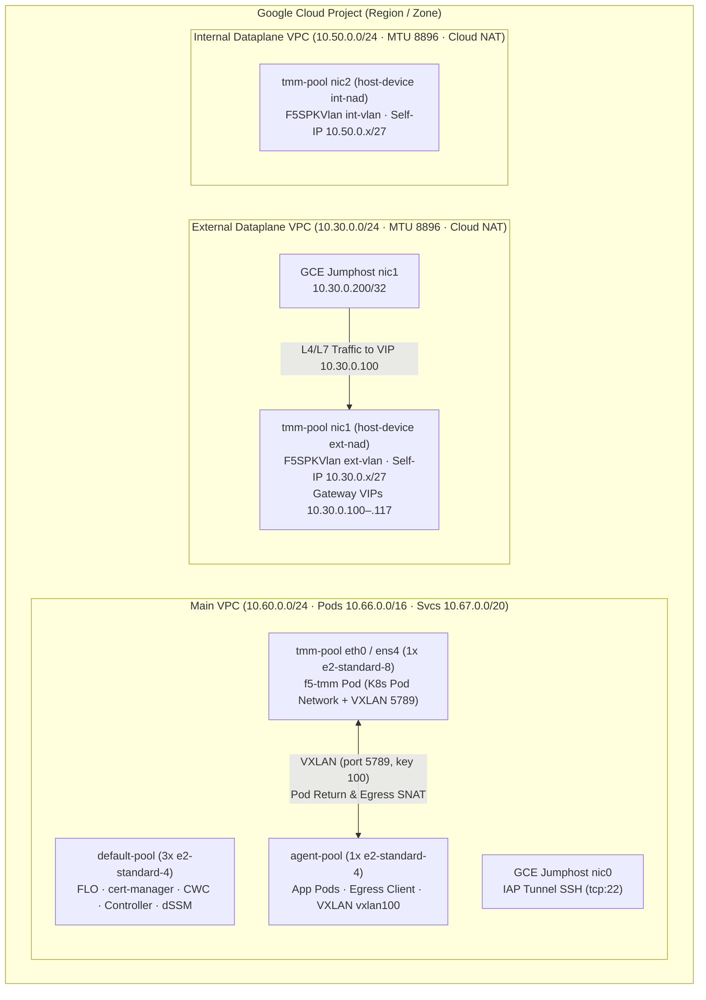

# gkebnkctl — F5 BIG-IP Next for Kubernetes (BNK) on Google GKE

[](go.mod)
[](internal/manifest)
[](examples/host-device/cluster.yaml)
[](LICENSE)

`gkebnkctl` is a single-binary Go CLI that provisions, validates, heals, upgrades, and benchmarks **F5 BIG-IP Next for Kubernetes (BNK) 2.4** on **Google Kubernetes Engine (GKE)** using secondary Compute Engine VPC NICs with the **Multus `host-device` CNI** pattern.

Starting from a single declarative `cluster.yaml`, `gkebnkctl up` orchestrates a 21-phase deployment pipeline: provisioning a 3-VPC Compute Engine topology (`main`, `external`, `internal`) with Cloud Router and Cloud NAT, launching a 3-pool GKE cluster (`default-pool`, multi-NIC `tmm-pool`, and `agent-pool`) alongside an IAP-accessible GCE jumphost, discovering runtime MAC-to-interface mappings on GKE 1.34/1.35 nodes, installing `cert-manager`, Multus CNI, F5 Lifecycle Operator (FLO), and `CNEInstance`, applying JWT subscription licensing via CWC REST, wiring external/internal `F5SPKVlan` CRDs and static routes, and configuring Gateway API L4/L7 ingress and VXLAN `F5SPKEgress` SNAT routing.

```text
┌──────────────────────────────────────────────────────────────────────────────┐
│                                  gkebnkctl                                   │
│   up · down · status · logs · bnk · scenarios · test · benchmark · forge     │
└───────────────┬──────────────────────┬───────────────────────┬───────────────┘
                │ gcloud               │ helm                  │ kubectl
                ▼                      ▼                       ▼
┌───────────────────────────┐  ┌───────────────────┐  ┌────────────────────────┐
│   Google Compute Engine   │  │     Google GKE    │  │      F5 BNK 2.4        │
│ • Main VPC (10.60.0.0/24) │  │ • default-pool    │  │ • cert-manager + Iss.  │
│ • Ext VPC  (10.30.0.0/24) │  │ • tmm-pool        │  │ • F5 Lifecycle Op (FLO)│
│ • Int VPC  (10.50.0.0/24) │  │   (3 NICs / node) │  │ • CNEInstance (2.4 CR) │
│ • Cloud Routers + NAT     │  │ • agent-pool      │  │ • F5SPKVlan (ext/int)  │
│ • GCE Jumphost (.200)     │  │ • Multus CNI      │  │ • Gateway + HTTPRoute  │
│   (IAP Tunnel SSH)        │  │   (host-device)   │  │ • F5SPKEgress + SNAT   │
└───────────────────────────┘  └───────────────────┘  └────────────────────────┘
```

---

## Features

- **Single-Binary Provisioning (`up` / `down`)** — Replaces fragile multi-script bash workflows with an idempotent, resumable 21-phase engine backed by workspace state (`<workspace>/state.env`).
- **Multi-NIC Host-Device Dataplane** — Attaches dedicated external (`nic1`) and internal (`nic2`) Compute Engine VPC interfaces directly into TMM pods via Multus `host-device` CNI, auto-discovering interface names (`ens5`/`eth1`, `ens6`/`eth2`) by MAC address at runtime across GKE 1.34 and 1.35 nodes.
- **Three-VPC Network Topology** — Provisions an isolated cluster-owned `main` VPC (`10.60.0.0/24` with secondary pod/service ranges) alongside shared or per-cluster `external` (`10.30.0.0/24`, MTU 8896) and `internal` (`10.50.0.0/24`, MTU 8896) dataplane VPCs, Cloud Routers, Cloud NAT, and GCP alias IP routes.
- **Three-Pool GKE Cluster** — Separates control-plane/operator workloads (`default-pool`), multi-NIC TMM dataplane nodes (`tmm-pool`), and application/egress workloads (`agent-pool`).
- **Full BNK 2.4 Control & Data Plane** — Automates `cert-manager`, self-signed cluster/local issuers, FAR image pull secrets, F5 Lifecycle Operator (FLO), `CNEInstance`, CWC REST JWT licensing, `F5SPKVlan`, and `F5SPKStaticRoute` reconciliation.
- **Declarative Gateway API + F5 CRDs** — Supports Kubernetes Gateway API v1 (`GatewayClass`, `Gateway`, `HTTPRoute`, `GRPCRoute`) alongside F5 BNK CRDs (`F5BnkGateway`, `F5SPKVlan`, `F5SPKStaticRoute`, `F5SPKEgress`, `F5SPKSnatpool`, `L4Route`, `BackendPolicy`).
- **Self-Healing BNK Reconciler (`bnk heal`)** — Detects and repairs 9 common BNK 2.4 runtime issues on GKE (Multus projected token mounts, TMM log stream sidecars, `f5-pod-manager` image overrides, CWC certs/DiagnosticService, dSSM Redis probes, controller EndpointSlices RBAC, TMM K8s pod CIDR static routes, EPP namespace labels, and test workload namespaces).
- **HTTPRoute Generation Bumper (`bnk resync`)** — Resolves the BNK 2.4.0 controller startup race where `HTTPRoute` objects applied before `Gateway` programming remain unattached (`bnk.f5.com/hostname-error: "true"`), with one-shot or continuous `--watch` mode.
- **BNK 2.3 → 2.4 Migration & Upgrade (`bnk migrate-2.4`, `bnk upgrade`)** — Translates legacy BNK 2.3 Helm values into `CNEInstance` + `F5BnkGateway` CRDs and executes zero-touch in-place release-manifest upgrades.
- **MCP Session Bootstrapper (`bnk mcp-session`)** — Renders and applies iControl LX MCP session configurations (`F5SPKiRule`, passphrase secrets, and Gateway listeners).
- **Built-In Scenario Harness (`scenarios`)** — Ships 15 self-contained end-to-end validation scenarios across L7 Ingress, L4 Load Balancing, Architecture & Tenancy, AI Gateway, Egress & SNAT, and Resilience & Diagnostics.
- **Live Performance Benchmarking (`benchmark`)** — Provisions `wrk`, `hey`, `ghz`, `iperf3`, and `ab` on the GCE jumphost over IAP SSH (`gcloud compute ssh --tunnel-through-iap`), drives multi-protocol load (HTTP, HTTPS, gRPC, TCP, UDP, and GenAI token/TTFT workloads) against BNK VIPs, and runs an in-cluster background benchmark daemon (`benchmark daemon`).
- **BNK Forge Control-Plane Integration (`forge`)** — Registers clusters with BNK Forge (`bnk-forge`), pushes health heartbeats, triggers remote benchmark suites, and tears down registrations automatically during `down`.
- **Comprehensive Preflight Doctor (`doctor`)** — Verifies local CLI dependencies (`gcloud`, `kubectl`, `helm`, `jq`), active GCP authentication, required GCP APIs (`container.googleapis.com`, `compute.googleapis.com`, `iam.googleapis.com`), and optional live Kubernetes cluster health (`--backend k8s`).
- **Scoped Kubectl & Kubeconfig Sync (`k`, `kubeconfig`)** — Runs `kubectl` scoped to the workspace cluster without polluting global state (`gkebnkctl k get pods -A`) or safely syncs credentials into `~/.kube/config` with automatic backup/restore (`--write-global` / `--restore-global`).
- **Live Cluster Topology Renderer (`topology`)** — Generates ASCII, Mermaid, Graphviz DOT, or JSON topology diagrams combining `cluster.yaml` intent with live Kubernetes node, pod, NAD, and Gateway discovery.
- **AI Coding Agent Harnesses (`agent`)** — Generates tailored workspace instruction files for Claude Code (`CLAUDE.md`), Cursor (`.cursor/rules/gkebnkctl.mdc`), Gemini (`GEMINI.md`), and OpenCode (`AGENTS.md`).

---

## Architecture

### Deployment Pipeline (21 Phases)

`gkebnkctl up -f cluster.yaml` executes 21 sequential, idempotent phases. Progress is persisted to `.gkebnkctl/<cluster-name>/state.env` so interrupted runs resume cleanly.

| Phase | Name | Description |
| :---: | :--- | :--- |
| `00` | `preflight` | Verify required CLI tools (`gcloud`, `kubectl`, `helm`, `jq`), active `gcloud` authentication, GCP APIs, and `license.jwt` / FAR secret files |
| `10` | `networks` | Provision `main`, `external` (MTU 8896), and `internal` (MTU 8896) VPCs, subnets, secondary IP ranges, firewall rules, and Cloud Routers + Cloud NAT |
| `15` | `jumphost` | Launch dual-NIC GCE jumphost (`main` + `external` at `.200`) reachable via GCP IAP SSH (`--tunnel-through-iap`) |
| `20` | `cluster` | Provision GKE cluster (`1.35`) with VPC-native alias IPs, `default-pool`, multi-NIC `tmm-pool` (`ext` + `int` additional node networks), and `agent-pool` |
| `25` | `discover` | Discover GKE node secondary NIC interface names (`ens5`/`eth1`, `ens6`/`eth2`), MAC addresses, gateway IPs, and TMM self-IPs; write `state.env` |
| `29` | `forge-register` | *(Optional)* Register the newly provisioned cluster with BNK Forge (`bnk-forge`) when `forge.enabled: true` |
| `30` | `namespaces` | Create BNK namespaces (`f5-cne-core`, `f5-cne-system`, `f5-bnk-instance`, `f5-utils`, and egress test namespace) |
| `31` | `cert-manager` | Install `cert-manager` (`v1.16.1`) via Helm and wait for webhook readiness |
| `32` | `issuers` | Create self-signed `ClusterIssuer` (`selfsigned-cluster-issuer`) and namespace `Issuer` resources for BNK mTLS |
| `33` | `far-secret` | Create `far-secret` (`docker-registry` pull secret for `repo.f5.com`) across all BNK namespaces and extract the BNK release manifest |
| `34` | `multus` | Install Multus CNI DaemonSet (`multus-ds`) and repair projected service account token watches |
| `35` | `nads` | Apply `NetworkAttachmentDefinition` CRDs (`ext-nad`, `int-nad`) using MAC-matched `host-device` interfaces discovered in Phase 25 |
| `36` | `flo` | Install F5 Lifecycle Operator (FLO) via Helm in `f5-cne-core` with image pull secrets and service account bindings |
| `37` | `node-sysctls` | Apply privileged DaemonSet on `tmm-pool` to disable `rp_filter` on secondary NICs and tune hugepages/socket buffers |
| `38` | `cneinstance` | Render and apply the BNK 2.4 `CNEInstance` CR (`f5-cne-system/bnk-instance`) with TMM resources, Multus NADs, and CWC configuration |
| `39` | `var-crash-patches` | Patch `/var/crash` volume permissions, `f5-pod-manager` image references, and dSSM probes for clean pod startup on GKE |
| `40` | `license` | Port-forward to CWC (`f5-spk-cwc`) and push the subscription `license.jwt` via the CWC REST API until verified |
| `41` | `vlans-routes` | Apply `F5SPKVlan` (`ext-vlan`, `int-vlan`) with `/27` self-IPs and `F5SPKStaticRoute` CRs (`route-ext-underlay`, `route-k8s-pods`), plus GCP VPC alias routes |
| `42` | `tmm-settle` | Wait for TMM BGP/zebos routing table convergence and verify external self-IP reachability from the GCE jumphost |
| `50` | `egress` | Deploy VXLAN `F5SPKEgress` + `F5SPKSnatpool` CRDs, `GatewayClass`, `Gateway`, sample workload (`echoserver`), and `HTTPRoute` |
| `51` | `ingress-vxlan-routes` | Reconcile VXLAN return routes (`vxlan100`) on GKE worker nodes and verify end-to-end ingress VIP (`.100`) and egress SNAT traffic |

### Network Topology



### Node Pools

| Node Pool | Default Machine Type | Default Nodes | Network Interfaces | Primary Role |
| :--- | :--- | :---: | :--- | :--- |
| `default-pool` | `e2-standard-4` | `3` | `nic0` (`main` VPC) | Control-plane operators: `cert-manager`, FLO (`f5-lifecycle-operator`), CNE controller (`f5-bnk-controller`), CWC (`f5-spk-cwc`), dSSM (`f5-dssm-db`), OTEL |
| `tmm-pool` | `e2-standard-8` | `1` | `nic0` (`main`), `nic1` (`external`), `nic2` (`internal`) | Dataplane `f5-tmm` DaemonSet (`host-device` secondary NICs passed into TMM via Multus `ext-nad` and `int-nad`) |
| `agent-pool` | `e2-standard-4` | `1` | `nic0` (`main` VPC) | Application backend pods (`echoserver`), egress test pods, and AI Gateway inference/EPP workloads |

---

## Prerequisites

### Required CLI Tools

Verify all prerequisites at any time with `gkebnkctl doctor`:

| Tool | Minimum Version | Purpose | Install (macOS) |
| :--- | :--- | :--- | :--- |
| `gcloud` | `450.0.0+` | Provision Compute Engine VPCs, GKE clusters, and IAP SSH tunnels (`gke-gcloud-auth-plugin` required) | `brew install --cask google-cloud-sdk` |
| `kubectl` | `v1.30+` | Apply Kubernetes manifests, CRDs, and inspect cluster state | `brew install kubernetes-cli` |
| `helm` | `v3.14+` | Install `cert-manager` and F5 Lifecycle Operator (FLO) charts | `brew install helm` |
| `jq` | `1.6+` | Parse GCP API JSON payloads and CWC licensing responses | `brew install jq` |

### Optional CLI Tools

| Tool | Purpose | Install (macOS) |
| :--- | :--- | :--- |
| `yq` | Inspect or mutate YAML manifests during debugging | `brew install yq` |
| `openssl` | Inspect CWC mTLS certificates and JWT payloads | `brew install openssl` |

### Required GCP Credentials & Permissions

1. Authenticate your local `gcloud` CLI and Application Default Credentials:
   ```bash
   gcloud auth login
   gcloud auth application-default login
   gcloud components install gke-gcloud-auth-plugin
   ```
2. Ensure the target GCP project has the following APIs enabled:
   - `container.googleapis.com` (Kubernetes Engine API)
   - `compute.googleapis.com` (Compute Engine API)
   - `iam.googleapis.com` (Identity and Access Management API)
   - `iap.googleapis.com` (Cloud Identity-Aware Proxy API — for jumphost SSH)
3. Required IAM roles on the target project:
   - `roles/container.admin` (Kubernetes Engine Admin)
   - `roles/compute.networkAdmin` & `roles/compute.instanceAdmin.v1` (Compute Network & Instance Admin)
   - `roles/iam.serviceAccountUser` (Service Account User)
   - `roles/iap.tunnelResourceAccessor` (IAP-secured Tunnel User)

### Required F5 Artifacts

Before running `gkebnkctl up`, place two gitignored credentials in your workspace `keys/` directory (or reference an existing Kubernetes context):

1. **F5 BNK Subscription JWT (`keys/license.jwt`)** — Raw JWT string used by Phase 40 to license CWC (`f5-spk-cwc`).
2. **F5 Artifact Registry (`repo.f5.com`) Credentials** — Configured via `bnk.farSecret` in `cluster.yaml`:
   - `source: dockerconfig` — Path to a local Docker config JSON (`keys/dockerconfig.json`) or FAR auth tarball (`keys/f5-far-auth-key.tgz`).
   - `source: kubecontext` — Copy an existing `far-secret` from another cluster context you already have in `~/.kube/config`.

---

## Installation

### Download Prebuilt Binary

Download the latest release for your platform (`darwin_arm64`, `darwin_amd64`, `linux_amd64`, `linux_arm64`) from GitHub Releases:

```bash
OS=$(uname -s | tr '[:upper:]' '[:lower:]')
ARCH=$(uname -m | sed 's/x86_64/amd64/;s/aarch64/arm64/')
curl -fsSL "https://github.com/JLCode-tech/gkebnkctl/releases/latest/download/gkebnkctl_${OS}_${ARCH}.tar.gz" | tar -xz
./gkebnkctl install
```

### Build from Source

Requires Go `1.25+`:

```bash
git clone https://github.com/JLCode-tech/gkebnkctl.git
cd gkebnkctl
make build
./bin/gkebnkctl install
```

`gkebnkctl install` copies the binary into `~/.local/bin/gkebnkctl` (or `/usr/local/bin` with `--dir /usr/local/bin`).

### Self-Update

Check for newer GitHub releases or update the installed binary in place:

```bash
gkebnkctl self check
gkebnkctl self update
```

---

## Quick Start

### 1. Verify Your Environment

```bash
gkebnkctl doctor --project my-gcp-project --region us-central1
```

### 2. Initialize a New Workspace

```bash
gkebnkctl init my-bnk-cluster \
  --project my-gcp-project \
  --name bnk-gke-01 \
  --region us-central1 \
  --zone us-central1-a
cd my-bnk-cluster
```

This creates:
- `cluster.yaml` — Declarative cluster & BNK 2.4 specification
- `keys/` — Gitignored directory for `license.jwt` and `dockerconfig.json`
- `artifacts/` — Output directory for `kubeconfig` and operational journals
- `AGENTS.md` — Quick-start runbook for operators and AI agents

### 3. Add F5 Credentials

```bash
cp /path/to/license.jwt keys/license.jwt
cp /path/to/dockerconfig.json keys/dockerconfig.json
```

### 4. Validate and Preview

```bash
gkebnkctl validate cluster.yaml
gkebnkctl up -f cluster.yaml --dry-run
```

### 5. Deploy the Full Stack

```bash
gkebnkctl up -f cluster.yaml
```

### 6. Sync Kubeconfig and Inspect

```bash
# Write workspace kubeconfig and sync to ~/.kube/config (for k9s / kubectl)
gkebnkctl kubeconfig -f cluster.yaml --write-global

# Inspect live cluster & BNK 2.4 component health
gkebnkctl status -f cluster.yaml

# Run scoped kubectl commands directly
gkebnkctl k get pods -A
gkebnkctl k get cneinstances,f5spkvlans,gateway -A
```

### 7. Run Scenarios and Tests

```bash
# Probe HTTP data-plane routing from the GCE jumphost through TMM VIP (.100)
gkebnkctl test traffic -f cluster.yaml

# Run all 15 built-in validation scenarios
gkebnkctl scenarios run --all -f cluster.yaml
```

### 8. Teardown

```bash
# Destroy GKE cluster, jumphost, and main VPC (shared ext/int VPCs are preserved by default)
gkebnkctl down -f cluster.yaml --yes
```

---

## Configuration Reference (`cluster.yaml`)

Below is a complete, annotated `cluster.yaml` showing all supported top-level sections:

```yaml
apiVersion: gkebnkctl/v1
kind: Cluster

metadata:
  name: bnk-hostdev
  project: my-gcp-project
  zone: us-central1-a
  labels:
    purpose: bnk-hostdev-demo

# Dataplane attachment pattern (host-device attaches secondary GCE NICs into TMM)
pattern: host-device

network:
  # Cluster-owned main VPC (created in Phase 10, deleted on `gkebnkctl down`)
  main:
    vpc: bnkhd-vpc
    subnet: bnkhd-subnet
    cidr: 10.60.0.0/24
    podsRangeName: bnkhd-pods
    podsCidr: 10.66.0.0/16
    svcsRangeName: bnkhd-svcs
    svcsCidr: 10.67.0.0/20

  # External dataplane VPC (shared or per-cluster; preserved on `gkebnkctl down`)
  external:
    vpc: bnkhd-ext
    subnet: bnkhd-ext
    cidr: 10.30.0.0/24
    mtu: 8896
    podsRangeName: tmm-ext-pods
    podsCidr: 10.31.0.0/24
    underlayCidr: 10.30.0.0/16

  # Internal dataplane VPC (shared or per-cluster; preserved on `gkebnkctl down`)
  internal:
    vpc: bnkhd-int
    subnet: bnkhd-int
    cidr: 10.50.0.0/24
    mtu: 8896
    podsRangeName: tmm-int-pods
    podsCidr: 10.51.0.0/24

  allowInternalCidr: 10.0.0.0/8
  natGateways: true

cluster:
  kubernetesVersion: "1.35"
  defaultPool:
    machineType: e2-standard-4
    nodeCount: 3
  tmmPool:
    name: tmm-pool
    machineType: e2-standard-8
    nodeCount: 1
    maxPodsPerNode: 8
  agentPool:
    name: agent-pool
    machineType: e2-standard-4
    nodeCount: 1
    maxPodsPerNode: 8

bnk:
  manifestVersion: "2.4.0-3.2882.0"
  tmmMtu: "1460"
  jwtPath: ./keys/license.jwt
  farSecret:
    source: dockerconfig          # "dockerconfig" or "kubecontext"
    dockerConfigFile: ./keys/dockerconfig.json
    sourceContext: ""
    sourceNamespace: f5-cne-core
    namespaces:
      - f5-cne-core
      - f5-cne-system
      - f5-bnk-instance
      - f5-utils
      - default

egress:
  testNamespace: bnk-demo
  vxlanPort: 5789
  vxlanKey: 100
  vxlanMtu: 1410

forge:
  enabled: false
  url: https://bnk-forge.example.com
  clusterId: ""

tags:
  env: lab
  purpose: bnk-hostdev-demo
```

### Key Configuration Fields

| Field | Default / Example | Description |
| :--- | :--- | :--- |
| `metadata.name` | `bnk-hostdev` | GKE cluster name and prefix for cluster-owned GCP resources |
| `metadata.project` | *(Required)* | Target Google Cloud project ID |
| `metadata.zone` | `us-central1-a` | Target GCP compute zone (region is derived automatically, e.g. `us-central1`) |
| `pattern` | `host-device` | Dataplane CNI pattern (`host-device` moves `nic1`/`nic2` into TMM network namespace) |
| `network.main.cidr` | `10.60.0.0/24` | Primary node subnet CIDR for the GKE `main` VPC |
| `network.main.podsCidr` | `10.66.0.0/16` | Secondary alias IP range for Kubernetes pods (`route-k8s-pods` target) |
| `network.main.svcsCidr` | `10.67.0.0/20` | Secondary alias IP range for Kubernetes ClusterIP services |
| `network.external.cidr` | `10.30.0.0/24` | External dataplane subnet CIDR (VIPs at `.100`–`.117`, jumphost at `.200`) |
| `network.external.mtu` | `8896` | Compute Engine VPC jumbo-frame wire MTU for external dataplane |
| `network.internal.cidr` | `10.50.0.0/24` | Internal dataplane subnet CIDR |
| `cluster.kubernetesVersion` | `"1.35"` | GKE Kubernetes minor version (`1.34` uses `ensN` NIC naming; `1.35` uses `ethN`, both auto-discovered) |
| `cluster.tmmPool.machineType` | `e2-standard-8` | Machine type for multi-NIC TMM nodes (must have $\ge 4$ vCPUs to support 3 VPC NICs on GCE) |
| `bnk.manifestVersion` | `"2.4.0-3.2882.0"` | F5 BNK release-manifest BOM version pulled from `repo.f5.com` |
| `bnk.tmmMtu` | `"1460"` | Logical `F5SPKVlan` MTU configured inside TMM (matches GCP standard 1460 TCP path MTU) |
| `bnk.jwtPath` | `./keys/license.jwt` | Path to F5 subscription JWT file (relative to `cluster.yaml`) |
| `bnk.farSecret.source` | `dockerconfig` | How `far-secret` is sourced: `dockerconfig` (local file) or `kubecontext` (copy from another cluster) |
| `egress.vxlanKey` | `100` | VXLAN VNI (`vxlan100`) used between TMM and worker nodes for pod return and `F5SPKEgress` SNAT |
| `forge.enabled` | `false` | Automatically register/unregister this cluster with a BNK Forge server during `up`/`down` |

---

## Command Reference

### Global Flags

Every `gkebnkctl` command accepts these persistent root flags:

| Flag | Short | Default | Description |
| :--- | :---: | :--- | :--- |
| `--verbose` | `-v` | `false` | Enable debug-level logging |
| `--quiet` | `-q` | `false` | Suppress non-essential informational output |
| `--no-color` | | `false` | Disable ANSI color output (also respects `NO_COLOR=1`) |
| `--workspace` | `-w` | `.` | Override workspace directory path |
| `--output` | `-o` | `text` | Output format (`text` or `json`) |

### All Commands

| Command | Category | Summary |
| :--- | :--- | :--- |
| `gkebnkctl up` | Lifecycle | Run the 21-phase provisioning pipeline from `cluster.yaml` (`--dry-run` supported) |
| `gkebnkctl down` | Lifecycle | Tear down GKE cluster, jumphost, and main VPC (`--yes`, `--dry-run`, `--keep-dataplane`) |
| `gkebnkctl validate` | Lifecycle | Validate `cluster.yaml` schema, CIDRs, node pool sizing, and secret references |
| `gkebnkctl init` | Lifecycle | Scaffold a new cluster workspace (`cluster.yaml`, `keys/`, `artifacts/`, `AGENTS.md`) |
| `gkebnkctl doctor` | Diagnostics | Check local CLI prerequisites, GCP auth/APIs, and optional live K8s health (`--backend k8s`) |
| `gkebnkctl status` | Diagnostics | Display GKE cluster state, node pools, BNK pods, CRDs, and Gateway VIPs (`-o json`) |
| `gkebnkctl logs` | Diagnostics | Stream logs for `flo`, `cis`, `cwc`, `cert-manager`, `cneinstance`, `fluentd`, or `tmm` (`--governance`, `--mcp`) |
| `gkebnkctl topology` | Diagnostics | Render cluster & BNK dataplane topology in `ascii`, `mermaid`, `dot`, or `json` |
| `gkebnkctl kubeconfig` | Kubernetes | Fetch GKE kubeconfig to `artifacts/kubeconfig` or sync with `~/.kube/config` (`--write-global`) |
| `gkebnkctl k` | Kubernetes | Execute `kubectl` scoped to the workspace cluster without changing global context |
| `gkebnkctl bnk` | Day-2 BNK | Day-2 BNK 2.4 operations: `heal`, `resync`, `migrate-2.4`, `upgrade`, `mcp-session` |
| `gkebnkctl scenarios` | Validation | List, run, and clean the 15 built-in end-to-end BNK validation scenarios |
| `gkebnkctl test` | Validation | Run targeted probes: `traffic` (jumphost VIP curl), `dns`, `connectivity`, `egress` |
| `gkebnkctl benchmark` | Performance | Provision jumphost load tools and run HTTP/HTTPS/gRPC/TCP/UDP/GenAI benchmarks (`setup`, `run`, `list`, `status`, `daemon`, `ingest`) |
| `gkebnkctl forge` | Control Plane | Register, inspect, benchmark, cleanup, or unregister clusters with BNK Forge (`bnk-forge`) |
| `gkebnkctl bnkforge` | Control Plane | Deprecated alias for `gkebnkctl forge` (retained for backward compatibility) |
| `gkebnkctl manifest` | Release BOM | Inspect the F5 BNK release-manifest Bill of Materials (`manifest probe [version] --all`) |
| `gkebnkctl agent` | AI Tooling | Generate AI assistant instructions for `gemini`, `claude`, `opencode`, `cursor`, or `all` |
| `gkebnkctl journal` | Audit Trail | Append or list structured workspace operations in `artifacts/journal.jsonl` (`add`, `list`) |
| `gkebnkctl install` | Binary Mgmt | Copy the running `gkebnkctl` binary into `~/.local/bin` or `--dir <path>` |
| `gkebnkctl self` | Binary Mgmt | Check for newer GitHub releases (`self check`) or update in place (`self update`) |
| `gkebnkctl version` | Metadata | Print binary version, git commit, Go runtime, and pinned BNK/GKE component versions |
| `gkebnkctl completion` | Shell | Generate shell autocompletion scripts for `bash`, `zsh`, `fish`, or `powershell` |
| `gkebnkctl help` | Help | Help about any command or subcommand |

> 📖 **Deep-Dive Guide:** See [docs/COMMANDS.md](docs/COMMANDS.md) for the complete CLI reference with every subcommand, flag, environment variable, and copy-pasteable example.

---

## Day-2 BNK Operations (`gkebnkctl bnk`)

### `gkebnkctl bnk heal` — 9 Idempotent Runtime Repairs

Inspects a live GKE BNK 2.4 cluster and applies targeted, idempotent repairs for known runtime failure modes:

```bash
# Preview all 9 repairs without mutating the cluster
gkebnkctl bnk heal -f cluster.yaml --dry-run

# Apply all needed repairs (or emit structured JSON report)
gkebnkctl bnk heal -f cluster.yaml
gkebnkctl bnk heal -f cluster.yaml -o json

# Run a specific subset of repairs
gkebnkctl bnk heal -f cluster.yaml --only cwc,tmm-k8s-routes
```

| Repair Name | Target Namespace | What It Fixes |
| :--- | :--- | :--- |
| `multus-token-watch` | `kube-system` | Ensures Multus DaemonSet mounts a projected service account token (`--serviceaccount-token-path`) so kubeconfig rotation never stalls CNI attachment |
| `tmm-log-stream` | `f5-cne-system` | Injects or repairs the `tmm-log-stream` sidecar on `f5-tmm` so TMM shared-memory logs stream cleanly to `kubectl logs` |
| `pod-manager` | `f5-cne-system` | Overrides broken `f5-pod-manager` image tags in `f5-tmm` DaemonSet when upstream manifest tags mismatch FAR |
| `cwc` | `f5-cne-core` | Reconciles CWC mTLS secrets (`cwc-license-certs`, `cwc-license-client-certs`), `DiagnosticService` CR, and LoadBalancer/ClusterIP service |
| `dssm-probe` | `f5-cne-system` | Repairs `f5-dssm-db` and `f5-dssm-sentinel` liveness/readiness TLS probe paths so Redis sentinels stabilize |
| `controller-endpointslices` | `f5-cne-system` | Grants `discovery.k8s.io/endpointslices` (`get`, `list`, `watch`) RBAC to `f5-bnk-controller` so Gateway backends populate |
| `tmm-k8s-routes` | `f5-cne-system` | Reconciles `F5SPKStaticRoute` (`route-k8s-pods`) pointing the GKE pod CIDR (`10.66.0.0/16`) at the internal VLAN self-IP |
| `epp-namespaces` | Cluster-wide | Labels Gateway API Inference Extension (EPP) namespaces so the BNK controller watches cross-namespace backends |
| `test-namespace` | `bnk-demo` / `egress-test` | Ensures the workload test namespace exists and carries required Gateway API watch labels |

### `gkebnkctl bnk resync` — HTTPRoute Generation Bumper

Fixes the BNK 2.4.0 startup race where `HTTPRoute` resources created before `Gateway` programming remain unattached with `bnk.f5.com/hostname-error: "true"`:

```bash
# Resync a single HTTPRoute or all affected HTTPRoutes in a namespace
gkebnkctl bnk resync my-route -n default
gkebnkctl bnk resync --all-in-ns -n default

# Run as a continuous background reconciler loop
gkebnkctl bnk resync --watch --debounce 15s
```

### `gkebnkctl bnk migrate-2.4` & `gkebnkctl bnk upgrade`

- **`gkebnkctl bnk migrate-2.4`** — Inspects a running BNK 2.3 cluster (or `cluster.yaml`) and generates the BNK 2.4 `CNEInstance` (`f5.com/v1alpha1`) + `F5BnkGateway` (`k8s.f5net.com/v1`) manifests (`--dry-run` by default, `--apply` to execute).
- **`gkebnkctl bnk upgrade`** — Upgrades an existing BNK 2.4 cluster to a newer release-manifest BOM (`--manifest-version 2.4.0-3.2882.0`), upgrading FLO via Helm and patching `CNEInstance.spec.manifestVersion`.
- **`gkebnkctl bnk mcp-session`** — Generates and applies iControl LX MCP session manifests (`F5SPKiRule`, passphrase `Secret`, and `Gateway` listener patches).

> 📖 **Deep-Dive Guide:** See [docs/UPGRADE-2.4.md](docs/UPGRADE-2.4.md) for the step-by-step BNK 2.3 → 2.4 migration runbook, schema mapping tables, and rollback procedures.

---

## Scenarios & Validation Suite

`gkebnkctl scenarios` provides 15 self-contained, idempotent scenarios that deploy real Kubernetes/BNK resources, verify data-plane traffic from the GCE jumphost, and clean up after themselves:

| # | Scenario Name | Category | Default VIP | What It Validates |
| :---: | :--- | :--- | :---: | :--- |
| 1 | `http-routing-e2e` | L7 Ingress | `10.30.0.100` | Gateway API `Gateway` + `HTTPRoute` L7 HTTP routing through TMM |
| 2 | `http-traffic-split` | L7 Ingress | `10.30.0.101` | Weighted 80/20 canary traffic splitting across two backend services |
| 3 | `grpc-loadbalance` | L7 Ingress | `10.30.0.102` | HTTP/2 `GRPCRoute` multiplexing and per-RPC load balancing |
| 4 | `tcp-l4-loadbalance` | L4 Load Balancing | `10.30.0.103` | Raw TCP load balancing via `L4Route` + Gateway TCP listener |
| 5 | `udp-l4-loadbalance` | L4 Load Balancing | `10.30.0.104` | Stateless UDP datagram load balancing via `L4Route` |
| 6 | `proxy-protocol-l4` | L4 Load Balancing | `10.30.0.105` | Client IP preservation using Proxy Protocol v2 `F5SPKiRule` + `BackendPolicy` |
| 7 | `external-resource-pool` | Architecture & Tenancy | `10.30.0.106` | Routing to external endpoints outside the K8s pod network via manual `Service` + `Endpoints` |
| 8 | `cluster-wide-watch` | Architecture & Tenancy | `10.30.0.107` | Cross-namespace `HTTPRoute` → `Gateway` attachment with ` ReferenceGrant` |
| 9 | `cwc-admin-access` | Architecture & Tenancy | *(Control Plane)* | CWC REST API mTLS connectivity, `DiagnosticService`, and JWT license status |
| 10 | `multi-vip` | Architecture & Tenancy | `.110`, `.111`, `.112` | Concurrent multi-VIP isolation across 3 distinct Gateway IP addresses |
| 11 | `ai-token-counting` | AI Gateway | `10.30.0.115` | GenAI prompt/completion token metering via iRule + OTEL telemetry |
| 12 | `ai-semantic-cache` | AI Gateway | `10.30.0.116` | Semantic prompt caching and fast-path response replay on TMM |
| 13 | `ai-inference-e2e` | AI Gateway | `10.30.0.117` | End-to-end LLM inference routing with Gateway API Inference Extension (EPP) |
| 14 | `egress-snat` | Egress & SNAT | *(Outbound)* | Outbound pod traffic SNATed through TMM external self-IP/pool via `F5SPKEgress` + `F5SPKSnatpool` |
| 15 | `core-file-collection` | Resilience & Diagnostics | *(Diagnostics)* | `/var/crash` core dump mount permissions and `f5-tmm` crash collection readiness |

```bash
# List all 15 scenarios with categories and descriptions
gkebnkctl scenarios list

# Run a single scenario or the entire suite
gkebnkctl scenarios run http-routing-e2e -f cluster.yaml
gkebnkctl scenarios run --all -f cluster.yaml

# Preview manifests without applying
gkebnkctl scenarios run multi-vip -f cluster.yaml --dry-run

# Clean up scenario resources
gkebnkctl scenarios clean http-routing-e2e -f cluster.yaml
gkebnkctl scenarios clean --all -f cluster.yaml
```

> 📖 **Deep-Dive Guide:** See [docs/SCENARIOS.md](docs/SCENARIOS.md) for architecture diagrams, CRD walkthroughs, and verification outputs for all 15 scenarios.

---

## Performance Benchmarking & BNK Forge

`gkebnkctl benchmark` drives real wire-speed load tests from the dual-NIC GCE jumphost (`10.30.0.200`) across the `external` VPC (`bnkhd-ext`, MTU 8896) directly into TMM VIPs over IAP SSH (`gcloud compute ssh --tunnel-through-iap`), eliminating public internet jitter.

```text
┌───────────────────────────┐   IAP Tunnel SSH    ┌───────────────────────────┐
│   Operator Workstation    │ ──────────────────▶ │  GCE Jumphost (.200)      │
│   gkebnkctl benchmark     │                     │  wrk · hey · ghz · iperf3 │
└───────────────────────────┘                     └─────────────┬─────────────┘
                                                                │ nic1 (10.30.0.0/24)
                                                                ▼
┌───────────────────────────┐   VXLAN / Pod Net   ┌───────────────────────────┐
│   Backend Pods            │ ◀────────────────── │  TMM Dataplane (tmm-pool) │
│   nginx / grpc / vllm     │                     │  VIP 10.30.0.100–.117     │
└───────────────────────────┘                     └───────────────────────────┘
```

### Jumphost Load Generation & In-Cluster Daemon

```bash
# 1. Install wrk, hey, ghz, iperf3, and ab on the GCE jumphost
gkebnkctl benchmark setup -f cluster.yaml

# 2. Run an HTTP/HTTPS/gRPC/TCP/UDP benchmark against a BNK VIP
gkebnkctl benchmark run -f cluster.yaml \
  --protocol http \
  --vip 10.30.0.100 \
  --duration 30s \
  --concurrency 64 \
  --threads 4

# 3. Ingest GenAI / LLM benchmark telemetry (TTFT, TPOT, tokens/sec) into BNK Forge
gkebnkctl benchmark ingest -f cluster.yaml --input results.json

# 4. Manage the in-cluster background benchmark daemon
gkebnkctl benchmark daemon start -f cluster.yaml
gkebnkctl benchmark daemon status -f cluster.yaml
```

### BNK Forge Integration (`gkebnkctl forge`)

```bash
# Register cluster with BNK Forge, check heartbeat status, and trigger remote benchmarks
gkebnkctl forge register -f cluster.yaml --forge-url https://bnk-forge.example.com
gkebnkctl forge status -f cluster.yaml
gkebnkctl forge benchmark -f cluster.yaml --suite standard
gkebnkctl forge unregister -f cluster.yaml
```

> 📖 **Deep-Dive Guide:** See [docs/BENCHMARKS.md](docs/BENCHMARKS.md) for full benchmarking methodology, GenAI token telemetry ingestion, daemon operations, and BNK Forge integration.

---

## Architecture Examples

The [`examples/`](examples/) directory contains 5 ready-to-use reference architectures:

| Example | Directory | Description |
| :--- | :--- | :--- |
| **Host-Device Baseline** | [`examples/host-device/`](examples/host-device/) | Canonical 3-VPC, 3-pool GKE BNK 2.4 `cluster.yaml` with Gateway API L7 ingress and VXLAN `F5SPKEgress` |
| **Outbound Egress & SNAT** | [`examples/egress/`](examples/egress/) | `F5SPKEgress` and `F5SPKSnatpool` manifests for deterministic outbound SNAT through TMM external IPs |
| **HTTP L7 Ingress** | [`examples/ingress/`](examples/ingress/) | Minimal Kubernetes Gateway API `GatewayClass`, `Gateway`, backend `Deployment`, and `HTTPRoute` |
| **Multi-Protocol Ingress** | [`examples/multi-protocol-ingress/`](examples/multi-protocol-ingress/) | Combined HTTP (`:80`), HTTPS TLS termination (`:443`), gRPC (`:9090`), and TCP (`:8443`) Gateway listeners |
| **Vertex AI Agent Demo** | [`examples/vertex-agent-demo/`](examples/vertex-agent-demo/) | Full GenAI agent & inference gateway architecture on GKE with token counting, semantic caching, and EPP routing |

---

## Project Structure

```text
gkebnkctl/
├── cmd/gkebnkctl/           # Main binary entrypoint
├── internal/
│   ├── agent/               # AI coding assistant harness generator (Claude, Cursor, Gemini, OpenCode)
│   ├── benchmark/           # Jumphost load runner (wrk, hey, ghz, iperf3) & GenAI telemetry ingest
│   ├── bnk/                 # Day-2 BNK 2.4 operations (heal, resync, migrate-2.4, upgrade, mcp-session)
│   ├── cli/                 # Cobra CLI command definitions (24 top-level commands)
│   ├── doctor/              # Preflight CLI, GCP auth/API, and live Kubernetes diagnostics
│   ├── forge/               # BNK Forge control-plane registration, heartbeats, and remote benchmarks
│   ├── gcp/                 # Compute Engine VPC, GKE cluster, NIC discovery, and phase orchestrator
│   ├── inspect/             # Live cluster status and multi-component log streaming
│   ├── intent/              # Declarative cluster.yaml parser, defaults, and schema validator
│   ├── journal/             # Append-only JSONL operational audit trail
│   ├── jumphost/            # GCE IAP SSH command runner and HTTP/TCP traffic prober
│   ├── kubeconfig/          # GKE credential fetcher and safe ~/.kube/config backup/sync
│   ├── manifest/            # F5 BNK release-manifest BOM extractor and verifier
│   ├── scenarios/           # 15 built-in end-to-end BNK validation scenarios
│   ├── self/                # GitHub Release checker and in-place binary self-updater
│   ├── test/                # DNS, connectivity, egress, and traffic probe runners
│   └── topology/            # ASCII, Mermaid, DOT, and JSON cluster topology renderer
├── docs/
│   ├── BENCHMARKS.md        # Deep-dive guide: Jumphost benchmarking, GenAI ingest & BNK Forge
│   ├── COMMANDS.md          # Deep-dive guide: Complete CLI reference for all 24 commands
│   ├── SCENARIOS.md         # Deep-dive guide: All 15 validation scenarios & CRD walkthroughs
│   └── UPGRADE-2.4.md       # Deep-dive guide: BNK 2.3 -> 2.4 migration & in-place upgrades
├── examples/                # 5 reference cluster.yaml & manifest architectures
├── hack/                    # Local CI gate runner (ci-local.sh)
└── scripts/                 # Vulnerability & release helper scripts
```

---

## Development & Testing

```bash
# Build ./bin/gkebnkctl
make build

# Run unit tests with race detector
go test -race ./...

# Run the full 11-gate local CI suite (fmt, vet, lint, gosec, govulncheck, tests, markdown, spellcheck)
./hack/ci-local.sh
./scripts/govulncheck-gate.sh
```

---

## Troubleshooting

- **`HTTPRoute` returns connection timeout on VIP `.100` right after deployment**
  Run `gkebnkctl bnk resync --all-in-ns -n default` to bump the `HTTPRoute` generation after the `Gateway` finishes programming (`bnk.f5.com/hostname-error: "true"`).
- **TMM pod stuck in `ContainerCreating` with Multus CNI error**
  Run `gkebnkctl bnk heal -f cluster.yaml --only multus-token-watch` to repair the Multus projected service account token mount, or verify `gkebnkctl k get net-attach-def -n f5-cne-system` matches the node NIC names discovered in Phase 25 (`ens5`/`eth1`, `ens6`/`eth2`).
- **CWC licensing fails in Phase 40 (`connection refused` or TLS error)**
  Run `gkebnkctl bnk heal -f cluster.yaml --only cwc,dssm-probe` to reconcile CWC mTLS certificates and dSSM Redis sentinel probes, then re-run `gkebnkctl up -f cluster.yaml`.
- **Pod backends do not receive return traffic from TMM**
  Run `gkebnkctl bnk heal -f cluster.yaml --only tmm-k8s-routes,controller-endpointslices` to ensure `route-k8s-pods` (`10.66.0.0/16`) and EndpointSlices RBAC are present.
- **Jumphost SSH fails during `gkebnkctl test traffic` or `benchmark`**
  Ensure Cloud IAP API (`iap.googleapis.com`) is enabled and your IAM principal has `roles/iap.tunnelResourceAccessor` on the project.

---

## License

Apache License 2.0 — see [LICENSE](LICENSE) for details.
