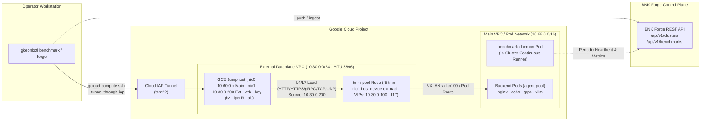

# Performance Benchmarking & BNK Forge Guide

`gkebnkctl` includes a built-in dataplane benchmarking subsystem (`gkebnkctl benchmark`) and control-plane integration with **BNK Forge** (`gkebnkctl forge`). Together, they enable repeatable wire-speed L4/L7 throughput, latency percentile, and GenAI token/TTFT measurements against F5 BIG-IP Next for Kubernetes (BNK) 2.4 on Google Kubernetes Engine (GKE).

---

## 1. Architecture Overview

To avoid public internet latency, NAT hairpins, or local laptop bandwidth limits, `gkebnkctl benchmark` executes load generators directly from the **dual-NIC GCE Jumphost** (`10.30.0.200`) provisioned in Phase 15.

- **Control Channel:** `gkebnkctl` connects from the operator workstation to `nic0` (`main` VPC) on the GCE jumphost over **Google Cloud Identity-Aware Proxy (IAP) SSH** (`gcloud compute ssh --tunnel-through-iap`).
- **Dataplane Channel:** The jumphost's secondary interface (`nic1`, `10.30.0.200`) sits directly on the `external` dataplane VPC (`10.30.0.0/24`, MTU `8896`) alongside the TMM `ext-vlan` self-IPs and Gateway VIPs (`10.30.0.100`–`10.30.0.117`).
- **Zero-Hop Wire Path:** Load traffic flows from jumphost `nic1` (`--interface 10.30.0.200`) across the Google Andromeda VPC fabric directly into the TMM `host-device` interface (`ens5`/`eth1`) on `tmm-pool`.



---

## 2. Provisioning Jumphost Load Generators (`benchmark setup`)

Before running your first benchmark on a newly deployed cluster, install the load-testing toolchain on the GCE jumphost:

```bash
# Preview the installation commands without executing over IAP SSH
gkebnkctl benchmark setup -f cluster.yaml --dry-run

# Install wrk, hey, apache2-utils (ab), ghz, iperf3, and jq on the GCE jumphost
gkebnkctl benchmark setup -f cluster.yaml
```

### Installed Toolchain

| Tool | Protocol Coverage | Primary Use Case |
| :--- | :--- | :--- |
| `wrk` | HTTP / HTTPS | High-throughput multi-threaded HTTP pipelining and RPS saturation |
| `hey` | HTTP / HTTPS | Rate-limited (`--rate`) HTTP latency distribution (`p50`, `p90`, `p95`, `p99`) |
| `ab` | HTTP / HTTPS | ApacheBench baseline single-threaded connection testing |
| `ghz` | gRPC (HTTP/2) | Protobuf / gRPC unary and streaming load testing across `GRPCRoute` |
| `iperf3` | TCP / UDP (L4) | Multi-stream L4 bandwidth (Gbps), retransmits, jitter, and packet-loss testing |

---

## 3. Running Dataplane Benchmarks (`benchmark run`)

`gkebnkctl benchmark run` automatically resolves the GCE jumphost instance, source IP (`10.30.0.200`), and default Gateway VIP (`10.30.0.100`) from `cluster.yaml` and `.gkebnkctl/<cluster>/state.env`.

### HTTP L7 Throughput & Latency (`wrk` / `hey`)

```bash
# Run a 30-second HTTP benchmark with wrk (default tool for HTTP)
gkebnkctl benchmark run -f cluster.yaml \
  --protocol http \
  --vip 10.30.0.100 \
  --port 80 \
  --path / \
  --duration 30s \
  --concurrency 64 \
  --threads 4

# Run a rate-limited HTTP benchmark with hey and emit structured JSON
gkebnkctl benchmark run -f cluster.yaml \
  --protocol http \
  --tool hey \
  --vip 10.30.0.100 \
  --host echo.example.com \
  --duration 60s \
  --concurrency 50 \
  --rate 2000 \
  -o json
```

### HTTPS TLS Termination Benchmark

```bash
gkebnkctl benchmark run -f cluster.yaml \
  --protocol https \
  --vip 10.30.0.100 \
  --port 443 \
  --host secure.example.com \
  --duration 30s \
  --concurrency 64
```

### gRPC HTTP/2 Multiplexing (`ghz`)

Pair with the `grpc-loadbalance` scenario (`10.30.0.102`):

```bash
# Deploy the gRPC scenario backend + GRPCRoute first
gkebnkctl scenarios run grpc-loadbalance -f cluster.yaml

# Drive gRPC load from the GCE jumphost
gkebnkctl benchmark run -f cluster.yaml \
  --protocol grpc \
  --tool ghz \
  --vip 10.30.0.102 \
  --port 9000 \
  --proto-service grpc.health.v1.Health/Check \
  --duration 30s \
  --concurrency 32
```

### L4 TCP & UDP Throughput (`iperf3`)

```bash
# TCP bandwidth test against an L4Route VIP
gkebnkctl benchmark run -f cluster.yaml \
  --protocol tcp \
  --tool iperf3 \
  --vip 10.30.0.103 \
  --port 5201 \
  --duration 30s \
  --concurrency 4

# UDP datagram throughput and packet-loss test
gkebnkctl benchmark run -f cluster.yaml \
  --protocol udp \
  --tool iperf3 \
  --vip 10.30.0.104 \
  --port 5201 \
  --duration 30s \
  --payload-size 1400
```

### Pushing Results to BNK Forge

Append `--push` (or configure `forge.enabled: true` in `cluster.yaml`) to upload run metrics automatically:

```bash
gkebnkctl benchmark run -f cluster.yaml \
  --protocol http \
  --vip 10.30.0.100 \
  --duration 30s \
  --concurrency 128 \
  --suite gke-hostdev-baseline \
  --push
```

---

## 4. GenAI & LLM Gateway Telemetry Ingestion (`benchmark ingest`)

When benchmarking AI Gateway scenarios (`ai-token-counting`, `ai-semantic-cache`, `ai-inference-e2e`, or the [`examples/vertex-agent-demo/`](../examples/vertex-agent-demo/) stack), `gkebnkctl benchmark ingest` normalizes and uploads LLM-specific performance metrics—**Time to First Token (TTFT)**, **Time Per Output Token (TPOT)**, **Tokens/sec**, and **Semantic Cache Hit Rate**—to BNK Forge.

### Ingest from a JSON Artifact

```bash
gkebnkctl benchmark ingest -f cluster.yaml \
  --input artifacts/genai-benchmark.json \
  --suite vertex-ai-gateway
```

### Ingest via CLI Flags

```bash
gkebnkctl benchmark ingest -f cluster.yaml \
  --model gemini-2.5-flash \
  --backend vertex-ai-epp \
  --concurrency 16 \
  --prompt-tokens 512 \
  --output-tokens 256 \
  --ttft-p50 42.5 \
  --ttft-p95 88.0 \
  --ttft-p99 124.3 \
  --tpot-p50 11.2 \
  --tpot-p95 16.8 \
  --tpot-p99 22.1 \
  --tokens-per-sec 1420.5 \
  --requests-per-sec 5.55 \
  --total-requests 500 \
  --failed-requests 0 \
  --duration-sec 90 \
  --cache-hit-rate 0.35
```

---

## 5. In-Cluster Benchmark Daemon (`benchmark daemon`)

For continuous regression tracking or long-running soak tests, `gkebnkctl benchmark daemon` deploys an in-cluster Deployment (`f5-utils/gkebnkctl-benchmark-daemon`) that periodically probes configured Gateway VIPs and streams telemetry to BNK Forge.

```bash
# Preview the daemon Kubernetes manifests
gkebnkctl benchmark daemon start -f cluster.yaml --dry-run

# Start the in-cluster benchmark daemon (default 5m interval)
gkebnkctl benchmark daemon start -f cluster.yaml --interval 5m

# Check daemon pod status and recent probe runs
gkebnkctl benchmark daemon status -f cluster.yaml

# Stream live daemon logs
gkebnkctl benchmark daemon logs -f cluster.yaml --follow

# Stop and remove the daemon Deployment
gkebnkctl benchmark daemon stop -f cluster.yaml
```

---

## 6. Inspecting Historical Runs (`benchmark list` & `benchmark status`)

```bash
# List recent benchmark runs recorded locally and in BNK Forge
gkebnkctl benchmark list -f cluster.yaml --limit 20

# Inspect detailed latency percentiles and throughput for a specific run ID
gkebnkctl benchmark status <run-id> -f cluster.yaml -o json
```

---

## 7. BNK Forge Control-Plane Integration (`gkebnkctl forge`)

**BNK Forge** (`bnk-forge`) is the centralized multi-cluster fleet registry and benchmark aggregator for `awsbnkctl`, `azrbnkctl`, and `gkebnkctl`.

### Declarative Configuration in `cluster.yaml`

When `forge.enabled: true` is set in `cluster.yaml`:
- **Phase 29 (`forge-register`)** automatically registers the GKE cluster during `gkebnkctl up`.
- **`gkebnkctl down`** automatically unregisters the cluster before deleting infrastructure.

```yaml
forge:
  enabled: true
  url: https://bnk-forge.example.com
  clusterId: gke-bnk-hostdev-01
```

You can also supply the Forge URL and API token via environment variables:
- `BNK_FORGE_URL` — Base URL of the BNK Forge server
- `BNK_FORGE_TOKEN` — Bearer token for authenticating to BNK Forge

### Manual Lifecycle Commands

```bash
# Register an existing GKE BNK cluster with BNK Forge
gkebnkctl forge register -f cluster.yaml --forge-url https://bnk-forge.example.com

# Check registration status, last heartbeat, and cluster metadata
gkebnkctl forge status -f cluster.yaml

# Trigger a coordinated benchmark suite and wait for completion
gkebnkctl forge benchmark -f cluster.yaml \
  --suite standard \
  --protocol http \
  --duration 30s \
  --concurrency 64 \
  --wait

# Clean up stale benchmark jobs/pods without unregistering the cluster
gkebnkctl forge cleanup -f cluster.yaml

# Unregister the cluster from BNK Forge
gkebnkctl forge unregister -f cluster.yaml
```

---

## 8. GKE Tuning Notes for Maximum Throughput

1. **Dual-MTU Separation (`8896` vs `1460`)** — The `external` and `internal` Compute Engine VPCs are provisioned with an `8896` byte jumbo-frame wire MTU so VXLAN encapsulation (`vxlan100`, 50-byte header) never fragments on the underlay, while `bnk.tmmMtu: "1460"` matches Google Cloud's native 1460-byte VPC path MTU inside TMM.
2. **Source Interface Pinning (`--interface 10.30.0.200`)** — Always drive traffic from the jumphost's secondary interface (`nic1`, `10.30.0.200`) on `bnkhd-ext`. `gkebnkctl benchmark run` and `gkebnkctl test traffic` automatically bind to `JUMPHOST_BNK_EXT_NIC_IP`.
3. **Node Sizing for Multi-NIC (`tmm-pool`)** — Google Compute Engine requires at least 4 vCPUs (`e2-standard-4` minimum; `e2-standard-8` or `c3-standard-8` recommended) to attach 3 VPC network interfaces (`main`, `external`, `internal`) to each `tmm-pool` node.
