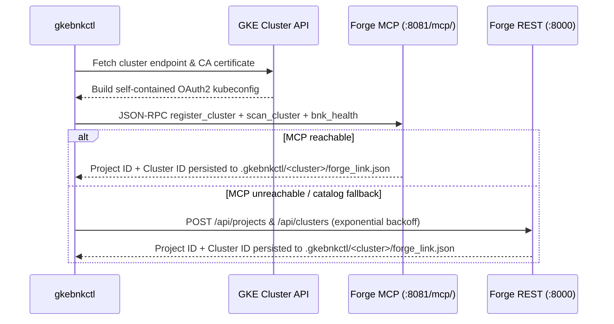

# BNK Forge & F5 BNK AI Service Plane Integration

`gkebnkctl` integrates natively with [**BNK Forge**](https://github.com/JLCode-tech/bnk-forge) (`bnk-forge`), the centralized multi-cloud control plane, scenario coordinator, **F5 BNK AI Service Plane** governance fabric, and AI benchmark harness for F5 BIG-IP Next for Kubernetes. For full platform documentation, see the [F5 BIG-IP Next for Kubernetes CloudDocs](https://clouddocs.f5.com/bigip-next-for-kubernetes/latest/overview.html).

---

## Overview

`gkebnkctl` provides two complementary ways to wire a GKE cluster into [BNK Forge](https://github.com/JLCode-tech/bnk-forge):

1. **Automatic Lifecycle Hooks (Phase 29)**: When `forge.enabled: true` is configured in `cluster.yaml`, `gkebnkctl up` automatically executes **Phase 29 (`forge-register`)** to create/reuse the Forge project, upload the cluster kubeconfig, and trigger an initial cluster scan (trying MCP first with automatic REST fallback). During teardown, `gkebnkctl down` runs `Phase29ForgeRegisterDown` to clean up cluster-scoped benchmark targets and unregister the cluster.
2. **Explicit CLI Subcommands (`gkebnkctl forge`)**: Register, inspect, govern **F5 BNK AI Service Plane** policies, benchmark, clean up, or unregister a workspace on demand over Forge's MCP endpoint (`http://localhost:8081/mcp/` by default, overridden via `--forge-mcp-url` or `GKEBNKCTL_FORGE_MCP_URL`) and REST API (`http://localhost:8000` by default).

> **Deprecation Note**: `gkebnkctl bnkforge` is a deprecated legacy alias. Use `gkebnkctl forge` for all workflows.

---

## CLI Usage (`gkebnkctl forge`)

```bash
# Register an active cluster with BNK Forge over MCP (and run post-register scan + bnk_health)
gkebnkctl forge register -f cluster.yaml --scan

# Override the MCP endpoint explicitly or via environment variable
export GKEBNKCTL_FORGE_MCP_URL="http://localhost:8081/mcp/"
gkebnkctl forge register -f cluster.yaml --forge-mcp-url http://localhost:8081/mcp/

# Query registration state and Forge MCP reachability
gkebnkctl forge status -f cluster.yaml

# Inspect and manage F5 BNK AI Service Plane governance via BNK Forge
gkebnkctl forge governance overview -f cluster.yaml
gkebnkctl forge governance bootstrap -f cluster.yaml
gkebnkctl forge governance test-request -f cluster.yaml
gkebnkctl forge governance remediate -f cluster.yaml

# Run an aiperf benchmark from the jumphost and push structured results to Forge
gkebnkctl forge benchmark -f cluster.yaml --scenario baseline

# Purge shared gkebnkctl-prefixed BenchmarkAgent and BenchmarkConfig records
gkebnkctl forge cleanup --workspace bnk-hostdev --forge-rest-url http://localhost:8000

# Unregister cluster from Forge (pass --purge to also delete the Forge project)
gkebnkctl forge unregister -f cluster.yaml
```

---

## Automatic Registration in `cluster.yaml` (Phase 29)

Add a `forge:` block to `cluster.yaml` to enable automatic registration during `gkebnkctl up` and automatic unregistration during `gkebnkctl down`:

```yaml
forge:
  enabled: true
  url: http://localhost:8000
  mcpUrl: http://localhost:8081/mcp/
  projectName: gkebnkctl-bnk-hostdev
  environment: lab
  cloudProvider: gcp
```

Credentials for the REST fallback and benchmark ingestion resolve from `forge.username` / `forge.password` or environment variables (`GKEBNKCTL_FORGE_USERNAME`, `GKEBNKCTL_FORGE_PASSWORD`, `GKEBNKCTL_FORGE_AGENT_TOKEN`).

---

## Architecture & Communication



### Workspace Link File (`.gkebnkctl/<cluster>/forge_link.json`)

When registration succeeds, `gkebnkctl` writes `.gkebnkctl/<cluster>/forge_link.json` tracking the Forge linkage:

```json
{
  "forge_url": "http://localhost:8000",
  "forge_mcp_url": "http://localhost:8081/mcp/",
  "workspace": "bnk-hostdev",
  "project_id": 1,
  "project_name": "gkebnkctl-bnk-hostdev",
  "cluster_id": 1,
  "cluster_name": "bnk-hostdev",
  "registered_at": "2026-09-02T15:00:00Z",
  "status": "registered"
}
```
If Forge is temporarily offline during `gkebnkctl up`, Phase 29 soft-fails with `"status": "pending"` so cluster provisioning completes cleanly; run `gkebnkctl forge register -f cluster.yaml` once Forge is reachable.
