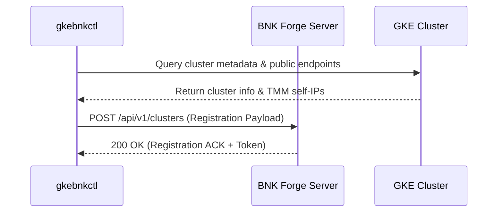

# BNK Forge Integration

`gkebnkctl` integrates natively with **BNK Forge** (`bnk-forge`), the centralized multi-cloud test harness and scenario coordinator for F5 BIG-IP Next for Kubernetes.

---

## Overview

BNK Forge manages live deployments, runs continuous multi-cloud benchmark suites, and correlates telemetry across AWS, GKE, ROKS, and OCI environments.

`gkebnkctl` provides the `bnkforge` CLI group to connect, register, and sync cluster status directly from the workstation:

```bash
# Register an active cluster with BNK Forge
gkebnkctl bnkforge register -f cluster.yaml --url https://forge.internal.domain

# Query cluster status from Forge
gkebnkctl bnkforge status -f cluster.yaml

# Unregister cluster upon teardown
gkebnkctl bnkforge unregister -f cluster.yaml
```

---

## Architecture & Communication



### Registration Payload Format

When registering with BNK Forge, `gkebnkctl` produces an aligned JSON payload:

```json
{
  "name": "gke-bnk-syd",
  "platform": "gke",
  "region": "australia-southeast1",
  "zone": "australia-southeast1-a",
  "kubernetes_version": "1.32.8-gke.1100",
  "bnk_version": "2.4.0",
  "dataplane": "host-device",
  "endpoints": {
    "external_vip": "10.10.1.100",
    "internal_vip": "10.20.1.100",
    "egress_client": "10.0.3.15"
  },
  "registered_at": "2026-09-02T15:00:00Z"
}
```

---

## Automation in CI/CD

To automatically register clusters created in CI pipelines, configure the following environment variables:

```bash
export FORGE_URL="https://forge.example.com"
export FORGE_TOKEN="secret-bearer-token"

# Provision and register
gkebnkctl up -f cluster.yaml
gkebnkctl bnkforge register -f cluster.yaml

# Run tests
gkebnkctl test -f cluster.yaml

# Teardown and unregister
gkebnkctl bnkforge unregister -f cluster.yaml
gkebnkctl down -f cluster.yaml --yes
```
