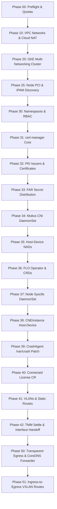

# Provisioning & Lifecycle Phases

`gkebnkctl up` executes an idempotent, 13-stage phase pipeline to provision the GKE infrastructure and configure F5 BIG-IP Next for Kubernetes (BNK).

---

## Phase Pipeline (`gkebnkctl up`)

---

## Phase Details

### Phase 00: Preflight
- Verifies GCP Application Default Credentials (ADC) or service account keys.
- Confirms mandatory APIs are enabled: `compute.googleapis.com`, `container.googleapis.com`, `iam.googleapis.com`.
- Inspects regional compute and IP quotas.

### Phase 10: Networks
- Provisions cluster-owned **Main VPC** with primary subnets and secondary ranges for pods (`/16`) and services (`/20`).
- Discovers or creates shared dataplane VPCs (**External** and **Internal**) configured with jumbo frame MTUs (8896).
- Deploys Cloud Router and Cloud NAT on the external network for egress Internet connectivity.

### Phase 20: Cluster
- Provisions GKE Datapath V2 cluster with multi-networking enabled.
- Creates dedicated node pools:
  - `default-pool`: System and management workloads (2 nodes, e2-standard-4).
  - `tmm-pool`: Data-plane TMM instances (1+ nodes, n2-standard-8 with secondary NICs).
  - `agent-pool`: Egress client and test applications (1 node, e2-standard-4).

### Phase 25: Discovery
- Runs an in-cluster discovery probe on TMM nodes using an ephemeral privileged pod.
- Discovers PCI slot addresses (`0000:00:04.0`, `0000:00:05.0`), MAC addresses, and GKE-assigned `/28` alias CIDRs.
- Caches discovered hardware topology in `.gkebnkctl/<cluster-name>/state.env`.

### Phase 30–33: Platform Foundations
- **Phase 30**: Creates namespaces (`f5-bnk`, `f5-utils`, `egress-test`).
- **Phase 31**: Applies static `cert-manager` v1.17.x manifests.
- **Phase 32**: Configures self-signed root CA and `ext-ca` cluster issuers.
- **Phase 33**: Distributes F5 FAR pull secret credentials into all required namespaces.

### Phase 34–39: CNE & Host-Device Subsystem
- **Phase 34**: Deploys Multus CNI daemonset and CRDs.
- **Phase 35**: Renders and applies host-device `NetworkAttachmentDefinition`s (`tmm-ext` and `tmm-int`) carrying static IPAM.
- **Phase 36**: Deploys F5 FLO Operator and applies SPK CustomResourceDefinitions using Server-Side Apply.
- **Phase 37**: Deploys `bnk-node-sysctls` DaemonSet to configure `core_pattern` on TMM nodes.
- **Phase 38**: Applies `CNEInstance` configuring DPDK TMM with host-device PCI passthrough.
- **Phase 39**: Injects `/var/crash` emptyDir storage into `f5-cne-controller` and `f5-crdconversion`.

### Phase 40–42: Data-Plane Activation
- **Phase 40**: Applies `License` CR with F5 subscription JWT in connected mode (auto-routing to CWC endpoints).
- **Phase 41**: Renders and applies `F5SPKVlan` interfaces and `F5SPKStaticRoute` routing table entries (including internal gateway interface routes).
- **Phase 42**: Performs reactive TMM settle and interface handoff verification.

### Phase 50–51: Egress & DSSM HA Forwarding
- **Phase 50**: Applies `F5SPKEgress`, deploys `coredns-f5` DaemonSet, updates `kube-dns` `stubDomains` for DSSM HA discovery, and deploys `egress-client`. Runs optional egress traffic verification.
- **Phase 51**: Discovers node VTEP addresses on agent-pool nodes and applies node-specific `F5SPKStaticRoute`s to resolve asymmetric return paths.

---

## Teardown (`gkebnkctl down`)

`gkebnkctl down` executes in reverse order:
1. Deletes GKE cluster and node pools.
2. Destroys Cloud NAT, Cloud Router, and Main VPC.
3. Checks ownership metadata on External and Internal dataplane VPCs: **Shared VPCs are preserved** if shared across clusters, or safely cleaned up if solely owned by the current cluster.
