# Provisioning & Lifecycle Phases

`gkebnkctl up` executes an idempotent, 21-phase pipeline (`00` through `51`) to provision the GKE infrastructure, optional jumphost, [BNK Forge](https://github.com/JLCode-tech/bnk-forge) registration, and F5 BIG-IP Next for Kubernetes (BNK). For official F5 platform documentation, see the [F5 BIG-IP Next for Kubernetes CloudDocs](https://clouddocs.f5.com/bigip-next-for-kubernetes/latest/overview.html).

---

## Phase Pipeline (`gkebnkctl up`)

```mermaid
graph TD
    P00["Phase 00: Preflight & Quotas"] --> P10["Phase 10: VPC Networks & Cloud NAT"]
    P10 --> P15["Phase 15: Jumphost VM & IAP SSH"]
    P15 --> P20["Phase 20: GKE Multi-Networking Cluster"]
    P20 --> P25["Phase 25: Node PCI & IPAM Discovery"]
    P25 --> P29["Phase 29: BNK Forge Registration"]
    P29 --> P30["Phase 30: Namespaces & CoreDNS Forwarder"]
    P30 --> P31["Phase 31: cert-manager Core"]
    P31 --> P32["Phase 32: PKI Issuers & Certificates"]
    P32 --> P33["Phase 33: FAR Secret Distribution"]
    P33 --> P34["Phase 34: Multus CNI DaemonSet"]
    P34 --> P35["Phase 35: Host-Device NADs"]
    P35 --> P36["Phase 36: FLO Operator & CRDs"]
    P36 --> P37["Phase 37: Node Sysctls DaemonSet"]
    P37 --> P38["Phase 38: CNEInstance Host-Device"]
    P38 --> P39["Phase 39: CrashAgent /var/crash Patch"]
    P39 --> P40["Phase 40: Connected License CR"]
    P40 --> P41["Phase 41: VLANs & Static Routes"]
    P41 --> P42["Phase 42: TMM Settle & Interface Handoff"]
    P42 --> P50["Phase 50: Transparent Egress"]
    P50 --> P51["Phase 51: Ingress-to-Egress VXLAN Routes"]
```

---

## Phase Details

### Phase 00: Preflight (`preflight`)
- Verifies GCP Application Default Credentials (ADC) or service account keys (skipped in `--dry-run` when `GKEBNKCTL_SKIP_AUTH=1`).
- Confirms mandatory APIs are enabled: `compute.googleapis.com`, `container.googleapis.com`, `iam.googleapis.com`.
- Inspects regional compute and IP quotas.

### Phase 10: Networks (`networks`)
- Provisions the cluster-owned **Main VPC** with primary subnet and secondary ranges for pods (`/16`) and services (`/20`).
- Discovers or creates shared dataplane VPCs (**External** and **Internal**) configured with jumbo frame MTUs (`8896`), plus per-cluster dataplane subnets tagged with a `gkebnkctl` ownership marker in `Description`.
- Deploys Cloud Router and Cloud NAT on the external and internal networks when `network.natGateways` is enabled (default `true`).

### Phase 15: Jumphost (`jumphost`)
- Feature-gated by `testing.jumphost.enabled` in `cluster.yaml` (skipped when `false`).
- Creates an IAP SSH ingress firewall rule (`<cluster>-allow-iap-ssh`, source `35.235.240.0/20`, TCP/22) on the external VPC.
- Provisions a Debian 12 GCE VM (`<cluster>-jumphost`, default `e2-micro`) attached to the external dataplane subnet for in-network VIP testing and `aiperf` benchmarking.

### Phase 20: Cluster (`cluster`)
- Provisions a GKE Datapath V2 cluster (default Kubernetes `"1.35"`) with multi-networking enabled.
- Creates dedicated node pools (defaults from `internal/intent/cluster.go`):
  - `defaultPool`: System and management workloads (default: **3 nodes**, `e2-standard-4`).
  - `tmmPool` (`tmm-pool`): Data-plane TMM instances with secondary external and internal NICs (default: **1 node**, `e2-standard-8`, `maxPodsPerNode: 8`).
  - `agentPool` (`agent-pool`): Egress client and test applications (default: **1 node**, `e2-standard-4`, `maxPodsPerNode: 32` in schema defaults / `8` in committed examples).

### Phase 25: Discovery (`discover`)
- Runs an in-cluster discovery probe on TMM and agent nodes using an ephemeral privileged pod (`nsenter -t 1`).
- Discovers PCI slot addresses (`0000:00:04.0`, `0000:00:05.0`), MAC addresses, interface names, and GKE-assigned `/28` alias CIDRs / self-IPs.
- Caches discovered hardware topology in `.gkebnkctl/<cluster-name>/state.env`.

### Phase 29: [BNK Forge](https://github.com/JLCode-tech/bnk-forge) Registration (`forge-register`)
- Feature-gated by `forge.enabled: true` in `cluster.yaml` (skipped when `false` or omitted).
- Generates a self-contained cluster kubeconfig and registers the cluster with [BNK Forge](https://github.com/JLCode-tech/bnk-forge) over MCP (`forge.mcpUrl`, default `http://localhost:8081/mcp/`) with exponential backoff and automatic REST fallback (`forge.url`, default `http://localhost:8000`).
- Persists registration linkage in `.gkebnkctl/<cluster-name>/forge_link.json` (soft-failing to `"status": "pending"` if Forge is unreachable so cluster provisioning never aborts).

### Phase 30–33: Platform Foundations
- **Phase 30 (`namespaces`)**: Creates all 6 required namespaces (`cert-manager`, `f5-cne-core`, `f5-cne-system`, `f5-bnk-instance`, `f5-utils`, and `egress.testNamespace` which defaults to `egress-test`), deploys the `coredns-f5` forwarder in `kube-system`, and patches the `kube-dns` ConfigMap `stubDomains` to forward `f5-cne-core.svc.cluster.local` to `coredns-f5` ClusterIP for DSSM StatefulSet headless DNS resolution.
- **Phase 31 (`cert-manager`)**: Applies vendored static `cert-manager` manifests.
- **Phase 32 (`issuers`)**: Configures self-signed root CA and `ext-ca` Certificate and ClusterIssuer resources.
- **Phase 33 (`far-secret`)**: Distributes F5 FAR pull secret credentials into all configured `bnk.farSecret.namespaces` (default: `f5-cne-core`, `f5-cne-system`, `f5-bnk-instance`, `f5-utils`, `default`).

### Phase 34–39: CNE & Host-Device Subsystem
- **Phase 34 (`multus`)**: Deploys Multus CNI ServiceAccount, RBAC, ConfigMap, NAD CRD, and DaemonSet.
- **Phase 35 (`nads`)**: Renders and applies host-device `NetworkAttachmentDefinition`s (`tmm-ext` and `tmm-int`) carrying discovered PCI addresses and static IPAM.
- **Phase 36 (`flo`)**: Deploys the F5 Lifecycle Operator (FLO) and applies SPK CustomResourceDefinitions using Server-Side Apply.
- **Phase 37 (`node-sysctls`)**: Deploys `bnk-node-sysctls` DaemonSet to configure `core_pattern` on TMM nodes.
- **Phase 38 (`cneinstance`)**: Applies `CNEInstance/instance` configuring DPDK TMM with host-device PCI passthrough.
- **Phase 39 (`var-crash-patches`)**: Injects `/var/crash` `emptyDir` storage into `f5-cne-controller` and `f5-crdconversion`.

### Phase 40–42: Data-Plane Activation
- **Phase 40 (`license`)**: Applies `License/bnk-license` CR with F5 subscription JWT in connected mode (auto-routing to CWC endpoints).
- **Phase 41 (`vlans-routes`)**: Renders and applies `F5SPKVlan` interfaces (`external-vlan`, `internal-vlan`) and 6 `F5SPKStaticRoute` entries (including `route-int-gw`).
- **Phase 42 (`tmm-settle`)**: Performs reactive TMM settle and interface handoff deadlock recovery.

### Phase 50–51: Transparent Egress & Symmetric Return Routing
- **Phase 50 (`egress`)**: Applies `F5SPKEgress`, deploys `bnk-agent-route-setter` DaemonSet and `egress-client` pod in `egress.testNamespace`, and runs optional egress traffic verification when `GKEBNKCTL_VERIFY_EGRESS=1`.
- **Phase 51 (`ingress-vxlan-routes`)**: Discovers live `vxlan100` VTEP addresses on agent-pool nodes and applies per-node `F5SPKStaticRoute`s to resolve ingress-to-egress-pod asymmetric return paths.

---

## Teardown (`gkebnkctl down`)

`gkebnkctl down` executes four ordered teardown steps:
1. **`Phase29ForgeRegisterDown`**: Deletes cluster-scoped benchmark targets in [BNK Forge](https://github.com/JLCode-tech/bnk-forge) and unregisters the cluster via MCP/REST when registered.
2. **`PhaseDownJumphost`**: Deletes the `<cluster>-jumphost` VM and `<cluster>-allow-iap-ssh` firewall rule if `testing.jumphost.enabled: true`.
3. **`PhaseDownCluster`**: Strips F5 BNK CR finalizers (best-effort) and deletes the GKE cluster and its node pools.
4. **`PhaseDownNetworks`**:
   - Deletes the cluster-owned **Main VPC** (`firewall` → `subnet` → `VPC`).
   - Unless `--keep-dataplane` is passed, cleans up cluster-owned resources inside the shared **External** and **Internal** dataplane VPCs: deletes per-cluster subnets carrying this cluster's `gkebnkctl` ownership marker, and — when no other cluster's marked subnets remain in the shared VPC — deletes the last-cluster-out marked firewall rules and Cloud Routers/NATs.
   - **Shared dataplane VPCs (`network.external.vpc` and `network.internal.vpc`) themselves are NEVER deleted by teardown.**
