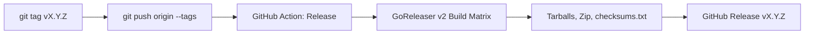

# Release Process

This document describes how `gkebnkctl` releases are built, tagged, and published.

---

## Release Pipeline

`gkebnkctl` uses **GoReleaser v2** inside GitHub Actions (`.github/workflows/release.yml`) to cross-compile single-binary distributions for Linux, macOS, and Windows.



---

## Target Matrix

GoReleaser produces archives for the following OS and architecture combinations:

| OS | Architecture | Binary / Archive |
|---|---|---|
| **Linux** | `amd64` (`x86_64`) | `gkebnkctl_X.Y.Z_linux_amd64.tar.gz` |
| **Linux** | `arm64` (`aarch64`) | `gkebnkctl_X.Y.Z_linux_arm64.tar.gz` |
| **macOS** (Darwin) | `amd64` (Intel) | `gkebnkctl_X.Y.Z_darwin_amd64.tar.gz` |
| **macOS** (Darwin) | `arm64` (Apple Silicon) | `gkebnkctl_X.Y.Z_darwin_arm64.tar.gz` |
| **Windows** | `amd64` (`x86_64`) | `gkebnkctl_X.Y.Z_windows_amd64.zip` |

Every release attaches a canonical `checksums.txt` containing SHA256 hashes for each archive.

---

## Creating a Release

### 1. Run Pre-Release Quality Gates Locally
```bash
# Run all local CI gates
bash scripts/ci-local.sh

# Or run the make target
make ci-local
```

### 2. Update the Changelog
Ensure `CHANGELOG.md` reflects all new features, bug fixes, and improvements for the new version.

### 3. Tag and Push
```bash
git tag v1.0.0
git push origin v1.0.0
```

GitHub Actions will trigger `.github/workflows/release.yml`, running GoReleaser to publish the artifacts.

---

## Verifying Downloads

To verify any release archive downloaded from GitHub:

```bash
# Download checksums and archive
curl -fsSL https://github.com/JLCode-tech/gkebnkctl/releases/download/v1.0.0/checksums.txt -o checksums.txt
curl -fsSL https://github.com/JLCode-tech/gkebnkctl/releases/download/v1.0.0/gkebnkctl_1.0.0_darwin_arm64.tar.gz -o gkebnkctl_1.0.0_darwin_arm64.tar.gz

# Verify SHA256
sha256sum -c checksums.txt --ignore-missing
```
