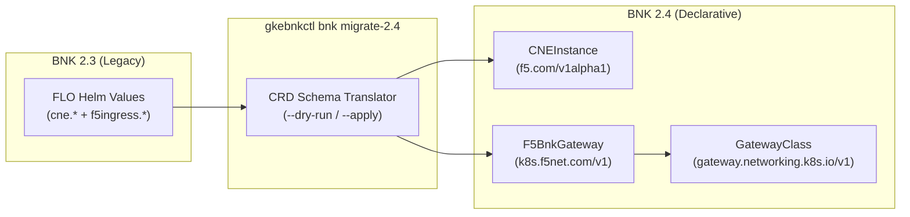

# BNK 2.3 to 2.4 Migration & Upgrade Guide (`gkebnkctl`)

This guide covers two Day-2 upgrade workflows for **F5 BIG-IP Next for Kubernetes (BNK)** on **Google Kubernetes Engine (GKE)**:

1. **Migrating from BNK 2.3 to BNK 2.4 (`gkebnkctl bnk migrate-2.4`)** — Translating legacy BNK 2.3 Helm release values (`f5ingress` / `flo-value.yaml`) into the declarative BNK 2.4 custom resource hierarchy (`CNEInstance` + `F5BnkGateway`).
2. **In-Place BNK 2.4 Release Upgrades (`gkebnkctl bnk upgrade`)** — Upgrading an existing BNK 2.4 cluster to a newer release-manifest Bill of Materials (BOM), such as `2.4.0-3.2882.0`.

---

## 1. What Changed Between BNK 2.3 and BNK 2.4?

In BNK 2.3, F5 Lifecycle Operator (FLO) consumed a sprawling `cne.values` block embedded directly inside the FLO Helm values file. In **BNK 2.4 (`2.4.0-3.2882.0`)**, configuration is split cleanly across two declarative Custom Resources and reconciled by FLO and the BNK Controller:

| Capability | BNK 2.3 (Legacy Helm Values) | BNK 2.4 (Declarative CRDs) |
| :--- | :--- | :--- |
| **Lifecycle & BOM Version** | `flo` Helm chart values (`cne.version`) | `CNEInstance` (`f5.com/v1alpha1`) in `f5-cne-system` (`spec.manifestVersion`) |
| **TMM Sizing & Hugepages** | `f5ingress.tmm.resources` in Helm values | `CNEInstance.spec.dataplane.tmm` + `F5BnkGateway` (`k8s.f5net.com/v1`) |
| **Multus NAD Attachments** | `cne.nads: [ext-nad, int-nad]` in Helm values | `CNEInstance.spec.dataplane.networkAttachmentDefinitions` + `F5BnkGateway` |
| **CWC & Licensing** | Embedded `cwc` chart toggles | `CNEInstance.spec.controlPlane.cwc` + `DiagnosticService` (`f5-cne-core`) |
| **VLAN Self-IPs** | Separate `/32` self-IP per node or manual config | Single `/27` prefix self-IP per `F5SPKVlan` (`ext-vlan`, `int-vlan`) in 2.4 single-node/HA topologies |
| **Gateway API Integration** | `GatewayClass` -> `Gateway` | `GatewayClass` (`parametersRef` -> `F5BnkGateway`) -> `Gateway` -> `HTTPRoute` / `GRPCRoute` / `L4Route` |



---

## 2. Migrating from BNK 2.3 to 2.4 (`gkebnkctl bnk migrate-2.4`)

`gkebnkctl bnk migrate-2.4` inspects your `cluster.yaml` (and optional live GKE cluster state) to synthesize compliant BNK 2.4 `CNEInstance`, `F5BnkGateway`, and `GatewayClass` manifests.

### Step 1: Preview the Generated 2.4 Manifests (`--dry-run`)

By default, `migrate-2.4` runs in safe `--dry-run` mode and prints the translated YAML manifests to `stdout`:

```bash
gkebnkctl bnk migrate-2.4 -f cluster.yaml --dry-run
```

You can customize the target namespace, infrastructure name, GatewayClass name, or single self-IP mode:

```bash
gkebnkctl bnk migrate-2.4 \
  -f cluster.yaml \
  -n f5-cne-system \
  --infra-name bnk-gateway-config \
  --gateway-class f5-gateway-class \
  --single-self-ip=true \
  --dry-run
```

### Step 2: Apply the Migration to the Cluster (`--apply`)

Once you have reviewed the generated `CNEInstance` and `F5BnkGateway` YAML:

```bash
gkebnkctl bnk migrate-2.4 \
  -f cluster.yaml \
  --apply \
  --wait
```

### Step 3: Run Post-Migration Self-Healing (`bnk heal` & `bnk resync`)

After migrating to BNK 2.4, run `bnk heal` and `bnk resync` to ensure all 2.4 RBAC permissions, EndpointSlice watches, and `HTTPRoute` bindings are active:

```bash
# Apply all 9 idempotent BNK 2.4 runtime repairs
gkebnkctl bnk heal -f cluster.yaml

# Re-synchronize any existing HTTPRoutes with the 2.4 Gateway controller
gkebnkctl bnk resync --all-in-ns -n default -f cluster.yaml
```

---

## 3. In-Place BNK 2.4 Release Upgrades (`gkebnkctl bnk upgrade`)

When a new BNK 2.4 release-manifest version is published to `repo.f5.com` (for example, upgrading from an earlier `2.4.0-*` build to `2.4.0-3.2882.0`), use `gkebnkctl bnk upgrade`.

### Step 1: Probe the Target Release Manifest BOM

Inspect the target release-manifest Bill of Materials (chart versions and container image tags) before touching the cluster:

```bash
gkebnkctl manifest probe 2.4.0-3.2882.0 --all
```

### Step 2: Preview the Upgrade Plan (`--dry-run`)

```bash
gkebnkctl bnk upgrade -f cluster.yaml \
  --manifest-version 2.4.0-3.2882.0 \
  --dry-run
```

`gkebnkctl bnk upgrade` performs the following steps:
1. Validates connectivity to the GKE cluster and checks `far-secret` in `f5-cne-core` and `f5-cne-system`.
2. Extracts the release-manifest BOM (`release-manifest:<version>`) to resolve the matching F5 Lifecycle Operator (FLO) Helm chart version (or uses `--flo-version` if explicitly overridden).
3. Upgrades the FLO Helm release in `f5-cne-core`.
4. Patches `CNEInstance.spec.manifestVersion` in `f5-cne-system` (default instance `bnk-instance`, overridable via `--instance`).
5. Waits up to `--timeout` (default `15m`) for `f5-tmm`, `f5-bnk-controller`, `f5-spk-cwc`, and `f5-dssm-db` pods to roll out and report `Ready`.

### Step 3: Execute the In-Place Upgrade

```bash
gkebnkctl bnk upgrade -f cluster.yaml \
  --manifest-version 2.4.0-3.2882.0 \
  --timeout 15m
```

### Step 4: Verify Post-Upgrade Health & Dataplane Traffic

```bash
# 1. Run post-upgrade self-healing checks
gkebnkctl bnk heal -f cluster.yaml

# 2. Check component status and CRD readiness
gkebnkctl status -f cluster.yaml

# 3. Verify live HTTP traffic from the GCE jumphost through the TMM VIP
gkebnkctl test traffic -f cluster.yaml
```

---

## 4. Reference: Generated BNK 2.4 Custom Resources

### `CNEInstance` (`f5.com/v1alpha1`)

```yaml
apiVersion: f5.com/v1alpha1
kind: CNEInstance
metadata:
  name: bnk-instance
  namespace: f5-cne-system
spec:
  manifestVersion: "2.4.0-3.2882.0"
  imagePullSecrets:
    - name: far-secret
  controlPlane:
    cwc:
      enabled: true
  dataplane:
    nodeSelector:
      cloud.google.com/gke-nodepool: tmm-pool
    networkAttachmentDefinitions:
      - name: ext-nad
      - name: int-nad
    tmm:
      defaultMtu: 1460
```

### `F5BnkGateway` (`k8s.f5net.com/v1`)

```yaml
apiVersion: k8s.f5net.com/v1
kind: F5BnkGateway
metadata:
  name: bnk-gateway-config
  namespace: f5-cne-system
spec:
  dataplane:
    vlans:
      - name: ext-vlan
      - name: int-vlan
```

---

## 5. Troubleshooting Upgrades on GKE

| Symptom | Root Cause | Resolution |
| :--- | :--- | :--- |
| `f5-tmm` pod stuck in `ImagePullBackOff` on `f5-pod-manager` after upgrade | Upstream manifest references an unpatched `f5-pod-manager` tag | Run `gkebnkctl bnk heal -f cluster.yaml --only pod-manager` |
| `HTTPRoute` status shows `bnk.f5.com/hostname-error: "true"` after controller restart | Controller restarted before Gateway listener reconciliation finished | Run `gkebnkctl bnk resync --all-in-ns -n default` |
| `f5-dssm-db` pods CrashLooping during rollout | Readiness TLS probe script path changed in 2.4 | Run `gkebnkctl bnk heal -f cluster.yaml --only dssm-probe` |
| Backend pods unreachable after `CNEInstance` rollout | `f5-bnk-controller` ClusterRole missing `endpointslices` RBAC or `route-k8s-pods` missing | Run `gkebnkctl bnk heal -f cluster.yaml --only controller-endpointslices,tmm-k8s-routes` |
