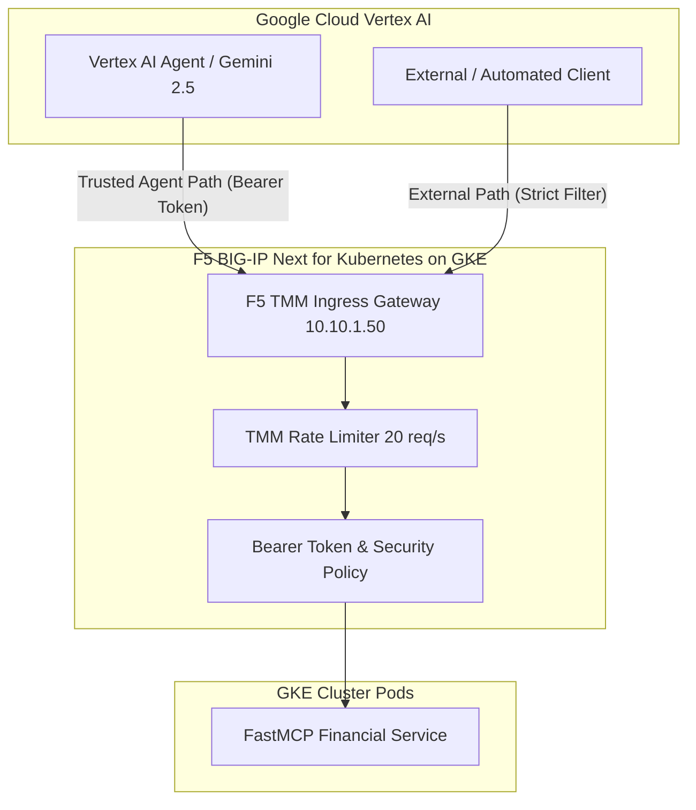

# Governing the Agentic Action Path: Google Cloud Vertex AI + F5 BNK on GKE

## Overview

As enterprises deploy autonomous AI agents into production on Google Cloud, securing the **action path**—where reasoning models transition into tool and API execution—becomes essential.

**Google Cloud Vertex AI Reasoning Engine** (powered by Gemini models such as `gemini-2.5-pro`) provides scalable reasoning, orchestration, and agent execution. When an agent invokes backend APIs, data services, or Model Context Protocol (MCP) servers, that traffic crosses critical enterprise networking and security boundaries.

**F5 BIG-IP Next for Kubernetes (BNK)** operates directly at this boundary on GKE:
- **High-Performance Multi-Networking**: Leverages GKE host-device secondary VPC interfaces and TMM data planes for deterministic L4-L7 traffic handling.
- **Action Path Governance**: Enforces per-agent rate limits, token authentication, and policy-driven routing for tool execution.
- **Enterprise Observability**: Streams comprehensive audit metrics, latency telemetry, and logs to BNK Forge and OpenTelemetry/Prometheus collectors.

---

## Architecture & Traffic Flow



### The Three Governed Paths

1. **Trusted Agent Path**:
   The agent runs within Google Cloud or GKE using Workload Identity Federation. It resolves `bnk-ingress.bnk-demo.internal` to the BNK Ingress VIP (`10.10.1.50`) and executes MCP tool calls. F5 BNK validates caller credentials, enforces rate limits, and routes the traffic to the backend tool.
2. **Double-Checked Path**:
   The agent invocation passes through **Vertex AI Extensions and Model Armor** for semantic validation, followed by **F5 BNK** on GKE for network isolation, MTU alignment, and DDoS protection.
3. **External / Stranger Path**:
   External callers or untrusted workloads targeting cluster ingress are strictly filtered and governed by F5 BNK, protecting sensitive backend operations such as financial forecasting and account balances.

---

## Directory Structure

```text
examples/vertex-agent-demo/
├── README.md                 # GKE & Vertex AI governance guide
├── cluster.yaml              # GKE cluster definition with host-device multi-networking
├── license.jwt               # F5 BNK license token placeholder
├── mcp-tool/
│   ├── mcp-server.py         # FastMCP Python service (forecast & get_account_balance)
│   ├── deployment.yaml       # K8s Deployment, Service, and Secret
│   └── kustomization.yaml    # Kustomize manifest generator
├── agent/
│   ├── vertex_agent.py       # Vertex AI Gemini agent runner
│   ├── requirements.txt      # Python dependencies
│   └── README.md             # Agent configuration guide
└── scripts/
    ├── demo.sh               # Automated deployment and verification script
    └── traffic-gen.sh        # High-volume traffic generator for rate-limit tests
```

---

## Step-by-Step Guide

### 1. Validate and Provision the Cluster
```bash
# Validate the GKE multi-network cluster manifest
gkebnkctl validate examples/vertex-agent-demo/cluster.yaml

# Provision GKE cluster with F5 BNK
gkebnkctl up -f examples/vertex-agent-demo/cluster.yaml
```

### 2. Connect Cluster to BNK Forge
```bash
# Register cluster into BNK Forge instance
gkebnkctl bnkforge register -f examples/vertex-agent-demo/cluster.yaml --url http://localhost:8000
```

### 3. Deploy MCP Tool and Services
```bash
kubectl apply -k examples/vertex-agent-demo/mcp-tool
```

### 4. Execute Governed Agent Reasoning
```bash
python3 examples/vertex-agent-demo/agent/vertex_agent.py --symbol GOOGL --days 30
```

### 5. Verify Rate Limiting and Traffic Governance
```bash
./examples/vertex-agent-demo/scripts/traffic-gen.sh 50
```
